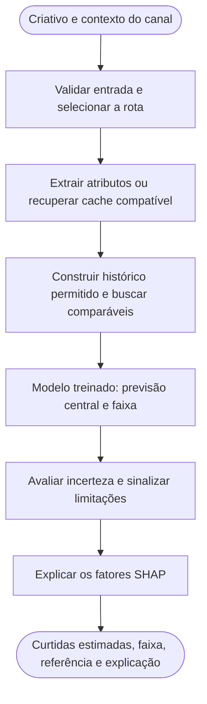
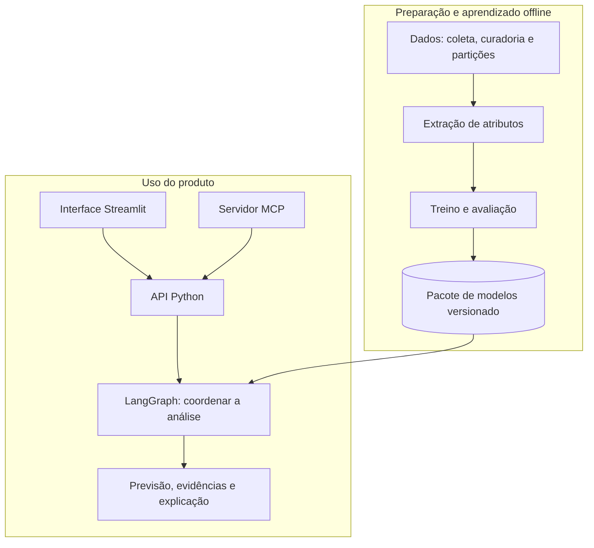

# CaseGalaxy

Agente preditivo para analisar criativos de YouTube Shorts e estimar seu potencial de curtidas considerando o histórico do canal. Projeto acadêmico Inteli Academy × Galaxies, com foco nos setores de beleza e automotivo.

Pela função Python ou pelo MCP, o usuário envia um vídeo, uma capa ou uma legenda planejada, informa o contexto do canal e recebe uma estimativa central, uma faixa de previsão, a comparação com a referência histórica e uma explicação dos fatores associados ao resultado. Também pode comparar de dois a cinco criativos do mesmo canal.

> A previsão apoia uma decisão; não garante o resultado da publicação. A faixa tem cobertura pretendida de 80%, mas cobriu 62,2% no procedimento de avaliação da rota local. O ganho para escolher criativos do mesmo canal ainda não foi demonstrado de forma consistente no desenvolvimento.

## Índice

- [O que o projeto entrega](#o-que-o-projeto-entrega)
- [Como usar](#como-usar)
- [Demonstração](#demonstracao-do-projeto)
- [Fluxo completo](#fluxo-completo)
- [Arquitetura de software](#arquitetura-de-software)
- [Dados e modelo preditivo](#dados-e-modelo-preditivo)
- [Estrutura do projeto](#estrutura-do-projeto)
- [Instalação do zero](#instalacao-do-zero)
- [Testes e avaliações](#testes-e-avaliacoes)

Os contratos, procedimentos de reprodução, resultados completos, retenção e licenças estão na [documentação técnica](docs/DOCUMENTACAO.md).

## O que o projeto entrega

- Previsão de curtidas com valor central e limites inferior e superior.
- Comparação com a referência histórica do canal e ranking de dois a cinco criativos compatíveis.
- Rota local de vídeo com extração em CPU e previsão sem Gemini nem chamadas de rede no modo offline.
- Rota Gemini preservada para análise de vídeo, além de modelos próprios para imagem e texto.
- Explicações SHAP, avisos de evidência limitada e identificação da rota e da versão do modelo.
- Interface Streamlit, função Python e servidor MCP usando a mesma lógica.
- Execução sobre vídeo e histórico informados pelo usuário; os modelos treinados já acompanham o clone.
- Pacotes versionados com hashes, configuração de treino e linhagem dos dados.

## Como usar

1. Clone o repositório e prepare o ambiente conforme as instruções abaixo; os modelos treinados já acompanham o código.
2. Abra a interface para analisar um arquivo de vídeo. Imagem, texto, URL pública e ranking são acessados pela função Python ou pelo MCP.
3. Informe o setor, a data planejada e o contexto do canal. Forneça o histórico próprio por CSV ou use um contexto local autorizado.
4. Envie o vídeo. A rota automática utiliza o preditor local quando ele está ativo; título e legenda são opcionais.
5. Clique em **Analisar** e consulte a previsão, a referência do canal, a faixa, as contribuições e os avisos.

Para comparar alternativas pela API Python ou pelo MCP, mantenha o mesmo canal, modalidade e rota. O formulário web atual analisa um vídeo por vez e não oferece ranking, imagem, texto ou entrada de URL. O ranking ordena estimativas do modelo; não equivale a um teste A/B de publicação. O modo online é opcional e precisa de configuração explícita; a experiência offline não exige chaves de API.

<a id="demonstracao-do-projeto"></a>
## Demonstração

A interface executa o modelo real sobre o vídeo enviado. Para testar, use um vídeo próprio e o histórico do seu canal, colado ou enviado como CSV. O arquivo `exemplos/historico_ficticio.csv` serve apenas para aprender o formato: seus números são inventados e não representam um canal real.

Também é possível executar no Windows:

```powershell
powershell -NoProfile -ExecutionPolicy Bypass -File .\executar_windows.ps1 prever-video -Video C:\caminho\video.mp4 -Canal meu_canal -Setor beleza -TipoCanal marca -Historico .\exemplos\historico_ficticio.csv
```

Substitua o CSV fictício pelo histórico autorizado do canal para uma análise de uso real. Os modelos treinados acompanham o repositório; não é necessário baixar os vídeos de treino nem retreinar. O ranking, imagem/texto e a rota Gemini continuam disponíveis pela API Python e pelo MCP; consulte a [documentação técnica](docs/DOCUMENTACAO.md#integracao).

## Fluxo completo

O caminho abaixo mostra uma previsão, desde a entrada até a resposta apresentada:



A interface recebe um arquivo de vídeo por análise. A função Python e o MCP também aceitam imagem, texto e URL pública, além do pedido de ranking. Para ordenar de dois a cinco criativos compatíveis, o agente percorre esse fluxo para cada item e ordena as previsões centrais.

As previsões concluídas na interface são salvas automaticamente em `data/privado/respostas_salvas/`, fora do Git. Use **Reprodução de resposta salva** para revê-las após reabrir o aplicativo, sem executar novamente o modelo. A pasta é criada no primeiro salvamento; não é necessário copiar arquivos manualmente.

O LightGBM calcula os números. No modo online, um LLM pode redigir a explicação, que é validada contra os valores calculados; no modo offline, o texto é determinístico. Nenhuma explicação altera a previsão.

## Arquitetura de software

O modelo é treinado previamente. Durante o uso, a aplicação carrega o pacote aprovado e executa a previsão:



A interface e o MCP compartilham a API e o fluxo de previsão. Os artefatos ficam em arquivos locais, sem banco externo, fila ou backend HTTP separado. As chamadas a YouTube e Gemini dependem de configuração online explícita. Consulte a [arquitetura detalhada](docs/DOCUMENTACAO.md#arquitetura).

## Dados e modelo preditivo

A base foi coletada pela YouTube Data API em 14/10/2026. A amostra ativa contém **1.500 vídeos de 16 canais**, sendo 12 de automotivo e quatro de beleza, além de 100 vídeos reservados para o limiar de largura da faixa.

O alvo é a quantidade de curtidas acumuladas na coleta para vídeos com pelo menos 30 dias de idade. Não é uma previsão de curtidas exatamente no 30º dia. O modelo aprende o desvio em escala logarítmica em relação ao histórico e converte a saída para curtidas.

O preditor local servido, **M2 / final=v2**, usa histórico e contexto mais dois embeddings visuais SigLIP 2, reduzidos por PCA a oito componentes cada: **28 colunas efetivas**. A extração também produz medidas de áudio, movimento, cortes, objetos, rosto e OCR; esses blocos foram experimentados, mas não foram selecionados para o M2 servido. Os modelos anteriores de vídeo Gemini, imagem e texto em `final=v1` são preservados.

| Resultado do procedimento local | Desenvolvimento | Teste temporal reutilizado |
|---|---:|---:|
| MAE em log | 1,059 | 1,148 |
| Spearman global | 0,685 | 0,738 |
| Spearman dentro do canal, mediana | 0,029 | 0,295 |
| Acerto entre pares distinguíveis do mesmo canal | 57,6% | 62,5% |

O teste já havia sido consultado no projeto; a coluna da direita é **exploratória**, não um novo teste independente. Os modelos servidos foram reajustados com os 1.500 alvos e ainda não possuem medição independente em vídeos futuros. Consulte os [resultados e comparações com baselines](docs/DOCUMENTACAO.md#resultados).

## Estrutura do projeto

```text
Entrega Galaxy/
├── src/
│   ├── dados/                  # Coleta, snapshots, curadoria, partições, datasets e histórico
│   ├── extracao/               # Vídeo, áudio, imagem e texto; pesos, cache e rubrica
│   ├── modelos/                # Pré-processamento, treino, refit e pacotes servidos
│   ├── avaliacao/              # Métricas, validação, experimentos, protocolos e avaliação final
│   ├── agente/                 # Contratos, API (prever e ordenar), grafo, atributos e explicação
│   ├── integracoes/            # YouTube, Gemini e servidor MCP
│   ├── interface_web/          # Interface Streamlit e lançador
│   ├── config.py, proveniencia.py, demonstracao.py
│   └── preprocessador.py, refit_audiovisual_preprocessador.py   # compatibilidade de serialização
├── configs/                   # Canais e configurações de preparação
├── data/execucao/             # Quatro modelos servidos, pré-processadores e manifesto
├── exemplos/                  # CSV fictício para aprender o formato de entrada
├── docs/DOCUMENTACAO.md        # Documentação técnica unificada
├── .streamlit/                # Configuração da interface
├── .env.example               # Nomes das variáveis, sem credenciais
├── executar_windows.ps1       # Preparação e execução no Windows
├── pyproject.toml             # Dependências e comandos públicos
├── uv.lock                    # Versões resolvidas
└── README.md                  # Apresentação e caminho de uso
```

O módulo a módulo está no [mapa de módulos](docs/DOCUMENTACAO.md#1-arquitetura-e-responsabilidades). `data/execucao/` acompanha o clone; o snapshot de pesquisa, descrições, e-mails, caches e a base de treino não são publicados. O histórico do canal é uma entrada do usuário, assim como o vídeo, e permanece local. Modelos e pré-processadores são os mesmos da avaliação, sem novo treinamento.

<a id="instalacao-do-zero"></a>
## Instalação do zero

### Pré-requisitos

- Windows com PowerShell ou Linux; Python 3.12, gerenciado pelo `uv`.
- Aproximadamente 8 GB livres para ambiente, cache e pesos; operações pesadas exigem memória livre adicional.
- Internet para instalar dependências e baixar os pesos oficiais. Após preparar os artefatos, a rota local funciona offline.
- Um vídeo próprio e histórico autorizado do canal para analisar; o CSV de exemplo é fictício.

### 1. Preparar o ambiente no Windows

Abra o PowerShell na pasta `Entrega Galaxy`:

```powershell
powershell -NoProfile -ExecutionPolicy Bypass -File .\executar_windows.ps1 preparar
```

O lançador prepara o Python 3.12 e o ambiente `.venv-windows` pelo lockfile. Se necessário, instala o `uv` localmente, sem alterar o PATH global.

### 2. Conferir os modelos incluídos

O clone já contém os quatro pacotes em `data/execucao/modelos/` e o manifesto `data/execucao/manifesto.json`. Não existe download separado de dados/modelos. Os modelos são carregados com verificação de integridade. O `.gitattributes` preserva os bytes desses arquivos, evitando conversão LF/CRLF pelo Git no Windows; mantenha esse arquivo no repositório. O histórico deve conter pelo menos cinco posts com curtidas, publicados pelo menos 30 dias antes da data planejada; inclua também posts recentes para calcular a cadência. Sem referência suficiente, o sistema recusa a previsão em vez de inventar um histórico setorial.

### 3. Obter os pesos oficiais

```powershell
powershell -NoProfile -ExecutionPolicy Bypass -File .\executar_windows.ps1 baixar
powershell -NoProfile -ExecutionPolicy Bypass -File .\executar_windows.ps1 preparar-av
powershell -NoProfile -ExecutionPolicy Bypass -File .\executar_windows.ps1 verificar
powershell -NoProfile -ExecutionPolicy Bypass -File .\executar_windows.ps1 verificar-av
```

Os downloads de legenda/capa somam cerca de 1,2 GB e os audiovisuais cerca de 2,1 GB. Os pesos de terceiros são obtidos das fontes oficiais pelos comandos acima. O serviço completo usa os dois conjuntos; a extração audiovisual isolada usa apenas o segundo.

### 4. Abrir a interface

```powershell
powershell -NoProfile -ExecutionPolicy Bypass -File .\executar_windows.ps1 app
```

Acesse `http://127.0.0.1:8501` e mantenha o terminal aberto. Se a porta estiver ocupada, inicie uma nova instância em outra porta:

```powershell
.\.venv-windows\Scripts\python.exe -m src.interface_web.lancar --porta 8502 --abrir-navegador
```

No Linux, use `uv sync --locked` e siga as instruções de [bibliotecas e pesos](docs/DOCUMENTACAO.md#instalacao); depois execute `uv run casegalaxy-interface --abrir-navegador`. Não compartilhe o ambiente virtual entre Linux e Windows.

<a id="testes-e-avaliacoes"></a>
## Testes e avaliações

O projeto separa três tipos de evidência: testes com componentes simulados, integração com modelos e mídia reais e avaliação estatística dos dados. Um teste funcional aprovado não mede acerto preditivo.

A seleção para o GitHub foi verificada em cópia limpa, sem o snapshot coletado: os quatro pacotes carregam, a página abre e a previsão local real, o ranking e os comparáveis do histórico informado funcionam. O formulário/adaptador e o MCP stdio retornaram os mesmos números da função Python. Os **148 testes pertinentes** passaram. Os 24 binários de modelos e pré-processadores permanecem idênticos; para a mesma entrada, quantis, referência e SHAP coincidem com a instalação de pesquisa. Essa verificação reaproveitou extrações reais por hash/configuração; não mediu novamente a extração a frio.

A rota local, a integração interface → API → modelo real (**14/14 verificações aprovadas**) e o lançador `prever-video` foram verificados no Windows nativo com a versão final do código, com números iguais entre função, grafo, chamada direta, recarga e MCP stdio. A previsão local e o ranking de dois vídeos do mesmo canal rodaram por MCP, offline e sem Gemini (rota `video_local`, `final=v2`). Os dois arquivos compartilham a imagem de origem e o canal é hipotético, de modo que é uma demonstração funcional: as estimativas centrais coincidiram e o resultado não indica qualidade de ordenação.

A suíte completa de referência no Windows nativo registrou **2.060 aprovados, 0 falhas, 0 erros e 5 ignorados** (522 s). Quatro testes ignorados dependem de CatBoost, que não integra o produto servido; o quinto trata de permissões de arquivo específicas do sistema e possui cobertura equivalente por simulação. A preparação da execução pelo repositório foi validada pelos 148 testes pertinentes e integrações descritos acima; a suíte completa não foi repetida nessa etapa. Os testes opcionais de comparação com CatBoost não estão aprovados na versão atual. Consulte o [alcance das verificações](docs/DOCUMENTACAO.md#verificacoes).

Para conferir o ambiente preparado:

```powershell
powershell -NoProfile -ExecutionPolicy Bypass -File .\executar_windows.ps1 verificar
powershell -NoProfile -ExecutionPolicy Bypass -File .\executar_windows.ps1 verificar-av
```

`demo` e `salvas` são utilitários de reprodução da pesquisa e exigem os artefatos privados correspondentes; não são etapas da instalação pública. O [guia técnico](docs/DOCUMENTACAO.md#verificacoes) registra o alcance e os limites de cada verificação, sem transformar contagens antigas em resultados atuais.

Os detalhes de [limitações e requisitos](docs/DOCUMENTACAO.md#limitacoes), [evolução](docs/DOCUMENTACAO.md#evolucao) e [retenção e licenças](docs/DOCUMENTACAO.md#dados-e-retencao) ficam na documentação técnica.
