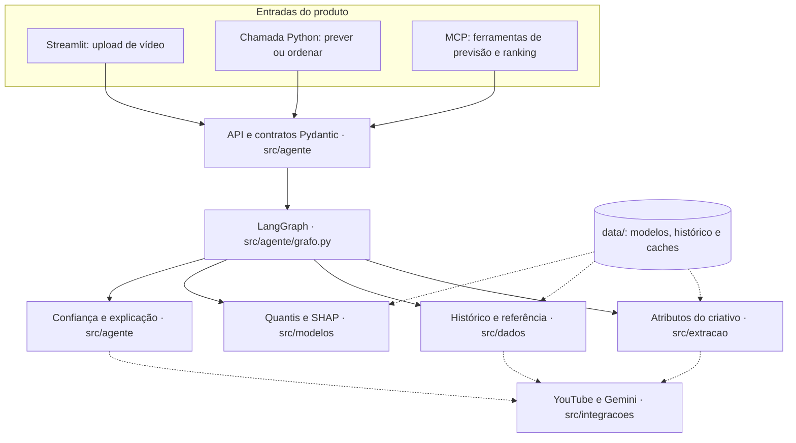
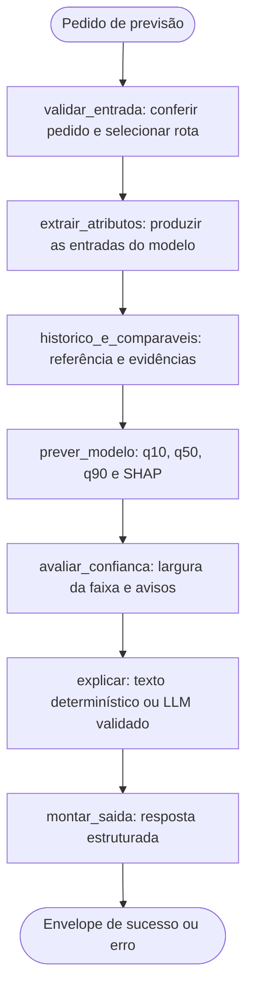
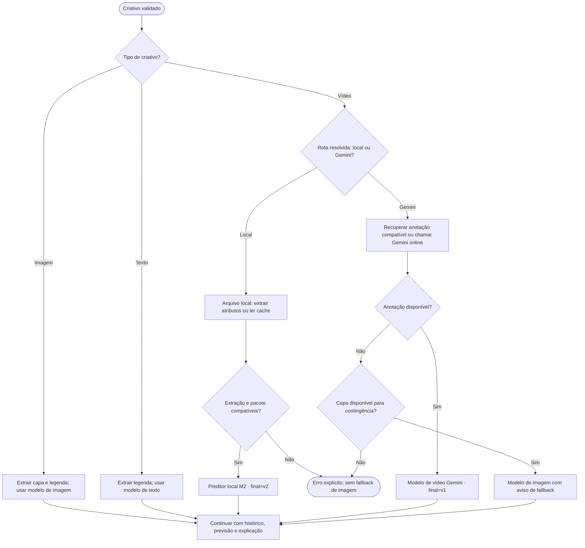
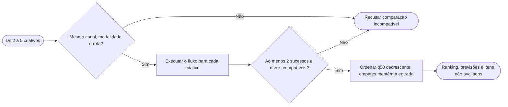
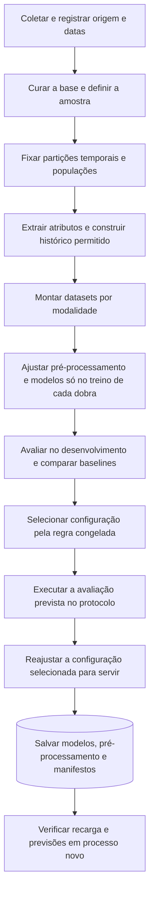

# Documentação técnica — CaseGalaxy

[Voltar ao README](../README.md)

Este documento concentra a arquitetura, os contratos de uso, a preparação do ambiente, os dados, a avaliação e as condições de operação do projeto. O README apresenta o produto e o caminho de uso; aqui ficam os detalhes necessários para compreender e reproduzir a implementação.

## Índice

1. [Arquitetura e responsabilidades](#arquitetura)
2. [Ficha do modelo e extração local](#modelo)
3. [Instalação e pesos](#instalacao)
4. [Distribuição e integridade](#distribuicao)
5. [Interface web](#interface)
6. [Função Python, MCP e modo online](#integracao)
7. [Demonstração](#demonstracao)
8. [Testes e verificações](#verificacoes)
9. [Resultados e avaliação](#resultados)
10. [Reprodução do treino](#reproducao)
11. [Registro e rastreabilidade](#rastreabilidade)
12. [Ficha dos dados, retenção e licenças](#dados-e-retencao)
13. [Limitações e requisitos](#limitacoes)
14. [Problemas de operação](#operacao)

<a id="arquitetura"></a>
## 1. Arquitetura e responsabilidades

### Objetivo e escopo

O CaseGalaxy estima curtidas acumuladas de YouTube Shorts para apoiar a análise de criativos antes da publicação. O recorte inclui beleza e automotivo, entradas de vídeo, imagem e texto e comparação de alternativas de um mesmo canal. Imagem representa capa planejada; texto representa legenda planejada. Não há previsão de visualizações, RAG, personas ou suporte a moda.

A aplicação roda localmente em Python e CPU. O Streamlit recebe as ações e mostra o resultado; a função Python e o servidor MCP atendem os mesmos casos de uso. Não existe backend HTTP separado, banco vetorial, banco relacional ou fila de execução externa.

### Camadas e dependências

As setas representam chamadas entre componentes. O armazenamento local fornece os modelos, o histórico e os caches necessários à análise.



As chamadas online, desenhadas com linhas tracejadas, dependem da rota e da configuração explícita do servidor. O caminho local offline utiliza arquivos e pesos já preparados. A função de extração isolada também é exposta pelo MCP e retorna atributos, sem executar a previsão.

`src/dados` prepara e consulta dados; `src/extracao` transforma mídia em atributos; `src/modelos` reúne pré-processamento, treino e uso dos pacotes; `src/avaliacao` executa os experimentos e relatórios. `src/agente` coordena esses componentes, `src/integracoes` contém as fronteiras externas e `src/interface_web` apresenta o resultado.

### Mapa de módulos

| Pacote | Módulos | Responsabilidade |
|---|---|---|
| `src/` | `config`, `proveniencia`, `demonstracao` | Chaves e raiz do projeto; SHA-256 e carimbos UTC compartilhados; demonstração por linha de comando |
| `src/dados` | `coleta`, `snapshot`, `curadoria`, `particoes`, `dataset`, `dataset_audiovisual`, `historico`, `anotacao`, `amostra` | Contratos e coleta do YouTube, snapshots, curadoria, partições temporais, datasets por modalidade e histórico do canal |
| `src/extracao` | `pipeline`, `video`, `video_local`, `audio`, `imagem`, `texto`, `embeddings`, `modelos`, `cache`, `rubrica`, `lote` | Extração local de vídeo, áudio, imagem e texto; pesos e ambiente; cache por conteúdo; rubrica e extração pelo Gemini; extração em lote |
| `src/modelos` | `preprocessamento`, `treino`, `modalidades`, `refit`, `pacote` | Pré-processamento, treino LightGBM e faixa, modelos por modalidade, refit final e pacotes servidos com manifesto |
| `src/avaliacao` | `metricas`, `validacao`, `experimentos`, `audiovisual`, `execucao_audiovisual`, `protocolos`, `protocolo_audiovisual`, `final`, `limiar`, `relatorio` | Métricas e bootstrap, dobras e portões, experimentos, protocolos congelados, avaliação final e limiar de largura da faixa |
| `src/agente` | `contratos`, `api`, `grafo`, `atributos`, `servicos`, `explicacao`, `comparaveis` | Contratos, `prever` e `ordenar`, fluxo LangGraph, atributos do criativo, dependências injetáveis, explicação e comparáveis |
| `src/integracoes` | `youtube`, `gemini`, `mcp` | Clientes externos com cota e livro de consumo; servidor MCP e fronteira de arquivos |
| `src/interface_web` | `app`, `lancar`, `formulario`, `validacao`, `resultados`, `adaptador`, `analise`, `arquivos`, `estado`, `textos`, `tema` | Interface Streamlit: só desenha; validação, adaptadores e análise ficam em módulos próprios |

Princípios da organização:

- **Sem ciclos.** O grafo de importações entre módulos é acíclico. Módulos de leitura leve (`video_local`, `agente/contratos`, `proveniencia`) não importam OpenCV, PyAV nem ONNX.
- **Uma previsão.** A função Python, o servidor MCP e a interface chamam `agente.api.prever` e `agente.api.ordenar`; o cálculo (`modelos`), a orquestração (`agente`) e a apresentação (`interface_web`) ficam separados.
- **Mecanismos compartilhados.** `proveniencia` concentra os SHA-256 e carimbos de tempo usados por manifestos, protocolos, caches e pacotes. O refit de vídeo, imagem e texto e o do preditor local usam o mesmo empacotamento (`modelos/refit.py`) e o mesmo treino (`modelos/treino.py`); o experimento de desenvolvimento reutiliza esse treino.
- **Roteiros com subcomando.** Módulos que reúnem vários roteiros de preparação aceitam o roteiro como primeiro argumento: `python -m src.dados.dataset {dataset_desenvolvimento|dataset_modalidades}`, `python -m src.modelos.treino {modelo_desenvolvimento|faixa_previsao|busca_parametros}`, `python -m src.modelos.refit {refit_dados|refit_treino|refit_verificacao}`, `python -m src.extracao.pipeline {cli|preparar}` e `python -m src.demonstracao {demonstracao|demonstracao_local}`. Os comandos públicos `casegalaxy-*` não mudam.
- **Compatibilidade de serialização.** Os modelos já treinados guardam as classes de pré-processamento com os caminhos `src.preprocessador` e `src.refit_audiovisual_preprocessador`. Esses dois módulos apenas reexportam as classes de `src/modelos/preprocessamento.py`, para que os modelos carreguem sem ser regravados. Não devem receber lógica.

### Fluxo de previsão

Estes são os sete nós definidos em `src/agente/grafo.py`, na ordem executada:



Uma falha interrompe o processamento útil das etapas seguintes e retorna um erro explícito; não são fabricados atributos ou previsões. O histórico respeita a defasagem de 30 dias e exclui o próprio vídeo quando sua identidade é conhecida. O grafo coordena funções definidas; não lança experimentos nem modifica modelos durante uma análise.

### Escolha da rota

O tipo do criativo e `video_route` determinam o processamento. Na opção `auto`, arquivo de vídeo utiliza o preditor local quando ele está ativo; URL pública ou ausência desse preditor segue a rota Gemini.



A rota `local` explícita exige vídeo em arquivo e pacote local ativo; caso contrário, o pedido é recusado. O fallback Gemini é identificado como `video_gemini_fallback_imagem`, com as limitações do modelo de imagem. Imagem e texto possuem seus próprios modelos e não executam o preditor local de vídeo.

### Ranking de criativos



O ranking utiliza a saída numérica do modelo; não é decidido pelo LLM. Comparáveis são evidências recuperadas da base, sem RAG. Contribuições SHAP descrevem o modelo e não efeitos causais.

<a id="modelo"></a>
## 2. Ficha do modelo e extração local

### Alvo e interpretação

O alvo interno é o desvio `r = log(1 + curtidas) − referencia_historica_log`. A referência é derivada do histórico permitido, e a saída é reconvertida para curtidas não negativas. O modelo produz q10, q50 e q90. Na conversão para exibição, a faixa usa o mínimo e o máximo das três saídas para corrigir cruzamentos, com corte em zero e transformação `expm1`; q50 permanece como estimativa central. A cobertura pretendida é 80%, sem garantia.

`relative_to_channel` expressa a razão suavizada `(1 + previsão central) / (1 + referência)`. Acima de um indica uma estimativa acima da referência utilizada. Isso não é um classificador binário validado de “acima ou abaixo da média”; o F1 em três faixas reportado na avaliação não é acurácia desse caso de uso.

A referência utiliza os últimos 20 posts elegíveis publicados pelo menos 30 dias antes da data planejada. Com menos de cinco posts, usa-se a referência do setor, com aviso. Canal fora da base e sem histórico informado ou consulta online é recusado. O snapshot não reconstrói perfeitamente as curtidas disponíveis no passado: rótulos e contagens históricas foram lidos em uma única coleta.

### Pacotes e entradas efetivas

`data/models/pacote_servido=v2.json` tem precedência quando existe; na sua ausência, vale o manifesto v1. O v2 acrescenta o modelo local sem substituir os modelos Gemini, imagem e texto em `final=v1`. Consulte a versão instalada com `uv run casegalaxy-pacote-servido mostrar`.

O modelo local M2 fica em `data/models/final=v2/video_local-1e8bdbcdd4c1-M2_c62b81db/`. São três regressores LightGBM quantílicos, com 300 árvores, taxa 0,05, sete folhas, mínimo de dez amostras por folha, regularização L2 igual a um e semente 20261015. A especificação definitiva de cada quantil está no `pacote.json` e nos metadados do pacote.

As entradas do M2 são 12 colunas de histórico/contexto e 16 componentes visuais: dois embeddings SigLIP 2 de 768 dimensões, cada um reduzido a oito componentes por PCA. São **28 colunas efetivas**, não 68 preditores. O extrator entrega 66 campos; o dataset acrescenta `avl_disponibilidade` e `avl_motivo`, totalizando 68 campos `avl_*`. Estados, hashes e identificadores não são preditores.

PCA, categorias raras e descarte de constantes são ajustados apenas no treino de cada dobra. O M2 foi selecionado entre os candidatos locais M1, M2 e M3 no desenvolvimento; as oito configurações experimentadas estão nos resultados. Áudio, fala, OCR, movimento e objetos foram extraídos e experimentados, mas não foram selecionados para o modelo servido M2.

Os pacotes finais foram reajustados com os 1.500 alvos, incluindo os rótulos do teste original. As métricas publicadas descrevem o procedimento de avaliação; ainda não existe avaliação independente dos artefatos servidos em novos vídeos.

### Extração e limites

| Etapa | Implementação |
|---|---|
| Sonda e decodificação | PyAV: duração, orientação, áudio e identidade do arquivo |
| Amostragem | De cinco a oito quadros, incluindo os primeiros três segundos |
| Medidas visuais | OpenCV: cor, luminosidade e movimento; PySceneDetect: cortes |
| Conteúdo dos quadros | BlazeFace: rosto; EasyOCR: texto; YOLOX-tiny: objetos COCO |
| Representação visual | SigLIP 2 |
| Áudio e fala | Energia e medidas espectrais; faster-whisper small em int8 |

O vídeo deve ter até 180 segundos e ser vertical ou quadrado. Interface e previsão MCP aceitam até 100 MB; a extração isolada aceita até 500 MB. Quadros têm até 960 px; a execução limita threads, carrega e libera componentes por etapa e utiliza cache por conteúdo, configuração e identidade do extrator. Escritas são atômicas e as etapas concluídas podem ser reaproveitadas. Quadros temporários são removidos ao final por padrão; a CLI isolada permite conservá-los com `--manter-quadros`, respeitando a retenção da mídia.

Ausência medida é diferente de falha: `sem_stream_audio`, `audio_sem_fala_detectada`, `transcricao_incerta` e `falha_extrator` não são intercambiáveis. Zero de rostos significa que o detector não encontrou rostos; objetos são restritos às classes COCO; energia não identifica música. A previsão local recusa extração com etapa em falha, mesmo quando o M2 não usa aquela medida.

A identidade do extrator instalado deve coincidir com a gravada no pacote. Alterar pesos, bibliotecas ou campos pode invalidar essa compatibilidade. A duração fornecida ao modelo deve seguir a transformação usada no treino, incluindo o teto em segundos.

### Incerteza e explicações

O limiar local de largura é o percentil 80 da faixa do próprio pacote nos 100 vídeos sem rótulo da LIM: 2,612 em log, IC 95% de 2,335 a 4,075. É um sinal de dispersão relativa, não uma probabilidade calibrada. O limiar da rota Gemini, 2,9733, pertence a outro pacote e não deve ser aplicado ao local.

SHAP explica o modelo na escala logarítmica. `exp(phi)` representa um fator sobre `1 + curtidas` com a referência fixada; não é uma promessa de aumento causal de curtidas ao editar o criativo.

<a id="instalacao"></a>
## 3. Instalação e pesos

Todos os comandos partem da pasta `Entrega Galaxy`. O Python aceito é 3.12; o `uv.lock` fixa as dependências. Use ambientes distintos: `.venv-windows` no Windows e `.venv` no Linux. Não distribua ambientes virtuais nem o diretório `.windows`.

### Windows

```powershell
powershell -NoProfile -ExecutionPolicy Bypass -File .\executar_windows.ps1 preparar
```

Esse comando procura o `uv` local ou no PATH; se necessário, instala a versão 0.12.23 em `.windows/ferramentas`. Prepara Python 3.12 e dependências pelo lockfile, incluindo `tzdata`. O bypass de execução vale somente para o processo indicado.

Os modelos treinados já acompanham o clone. Obtenha os pesos oficiais:

```powershell
powershell -NoProfile -ExecutionPolicy Bypass -File .\executar_windows.ps1 baixar
powershell -NoProfile -ExecutionPolicy Bypass -File .\executar_windows.ps1 preparar-av
powershell -NoProfile -ExecutionPolicy Bypass -File .\executar_windows.ps1 verificar
powershell -NoProfile -ExecutionPolicy Bypass -File .\executar_windows.ps1 verificar-av
```

`baixar` obtém os codificadores de legenda/capa; `preparar-av`, os audiovisuais. Os comandos de verificação só conferem os arquivos. A preparação do ambiente também usa rede; após preparar ambiente, dados e pesos, a inferência offline não precisa de conexão. O serviço completo requer os dois conjuntos de pesos. A extração isolada requer apenas os audiovisuais.

### Linux

```bash
uv sync --locked
uv run casegalaxy-demo --verificar-ambiente
```

O sistema precisa de `libgomp.so.1`, `libGLESv2.so.2` e `libEGL.so.1`. No Ubuntu, o comando usual é `sudo apt install libgomp1 libgles2 libegl1`. As bibliotecas foram verificadas por pacotes extraídos e caminhos locais; a instalação por esse comando `apt install` não foi executada na verificação registrada.

Reserve aproximadamente 8 GB para ambiente, cache e pesos. Os scripts de avaliação e de verificação usam uma trava de operação pesada e conferem a memória livre: o portão é de 2,5 GB para operações pesadas (extração completa de um vídeo, carga do pacote real em testes) e de 1 GB para previsões leves com extração em cache. Esses limites são operacionais; não garantem o consumo máximo nem são requisito uniforme da interface. Extração a frio pode levar minutos; cache reduz o tempo, sem garantia de latência.

Copie `.env.example` para `.env` somente se precisar configurar variáveis. Não são necessárias chaves no modo offline. Nunca publique o `.env`.

### Pesos dos codificadores de legenda e capa (não vão no pacote de execução)

O runtime carrega estes pesos, todos em CPU. Cada pessoa os baixa da fonte oficial: nenhuma permissão de redistribuição foi estabelecida. O que as fontes oficiais declaram (consultadas em 19/10/2026): e5-small, MIT no cartão; MediaPipe BlazeFace, Apache-2.0 na ficha do modelo; CLIP (pesos) e EasyOCR (pesos): licença não confirmada (o código de ambos é MIT e Apache-2.0, respectivamente); o cartão do CLIP limita o uso a pesquisa e declara fora de escopo o uso implantado. Detalhes e fontes em [dados, retenção e licenças](#dados-e-retencao).

| Componente | Fonte | Onde fica | Tamanho | Revisão |
|---|---|---|---|---|
| `intfloat/multilingual-e5-small` | Hugging Face | `$HF_HUB_CACHE`, ou `$HF_HOME/hub`, ou `~/.cache/huggingface/hub` | 471 MB | `614241f622f53c4eeff9890bdc4f31cfecc418b3` |
| `openai/clip-vit-base-patch32` | Hugging Face | idem | 605 MB (`pytorch_model.bin`) | `3d74acf9a28c67741b2f4f2ea7635f0aaf6f0268` (a `refs/main` usada no desenvolvimento) |
| EasyOCR `craft_mlt_25k.pth` e `latin_g2.pth` | baixados pelo próprio EasyOCR | `~/.cache/casegalaxy/easyocr` | 83 MB e 15 MB | SHA-256 `4a5efbfb…db17` e `aaa95be1…8c55` |
| MediaPipe `blaze_face_short_range.tflite` | `storage.googleapis.com/mediapipe-models/...` | `~/.cache/casegalaxy/mediapipe` | 230 KB | SHA-256 `b4578f35…0152f` |

```bash
uv run casegalaxy-demo --verificar-ambiente      # somente leitura; tamanho e SHA-256 de cada arquivo, libs do sistema e `refs/main` de e5 e CLIP; sai com 3 se algo faltar ou divergir
uv run casegalaxy-demo --baixar-codificadores    # opt-in; confere as libs antes (sem lib: sai 3 e não baixa nada); imprime os tamanhos; só o que falta
```

No Windows, os mesmos passos são as ações `baixar` e `verificar` do lançador.

- Os manifestos de treino gravam `revisao: null` para e5 e CLIP: a reprodutibilidade depende dessas revisões. `--baixar-codificadores` usa as fixas acima e cria `refs/main` quando falta, para o runtime offline achar o snapshot.
- Falta de peso ou de biblioteca do sistema: `casegalaxy-demo`, `casegalaxy-mcp` e `Servicos.padrao()` conferem o ambiente antes de carregar modelos e listam cada item ausente com tamanho, caminho esperado e o comando. `casegalaxy-demo` e `casegalaxy-mcp` saem com código 3; a função levanta `src.extracao.modelos.AmbienteIncompleto`. Nenhuma delas baixa pesos sozinha. O servidor MCP também força `HF_HUB_OFFLINE=1`. `--baixar-codificadores` leva cerca de 4 minutos e baixa 1,2 GB, só do que falta; conserta `refs/main` quando falta ou diverge (e5 e CLIP) e repara peso com tamanho ou SHA-256 divergente movendo-o para `<nome>.divergente` e baixando de novo. O diretório do cache do Hugging Face é o mesmo do runtime e respeita `HF_HUB_CACHE`, `HF_HOME` e `XDG_CACHE_HOME`. A checagem de bibliotecas do sistema só vale no Linux; fora dele só os pesos são conferidos. As mensagens do servidor MCP ao cliente não levam caminhos absolutos (os completos vão para o stderr).

### Pesos da camada audiovisual local

Usados pela extração local e, portanto, pela rota local. Dependências do `uv.lock`: `av`, `faster-whisper`, `scenedetect`, `onnxruntime` e suas transitivas. O PySceneDetect 0.7.2 exige `opencv-python`; o `pyproject.toml` neutraliza essa exigência com um `override-dependencies` para que só o `opencv-python-headless` do projeto fique instalado (os dois instalam o mesmo módulo `cv2`).

| Passo | Comando | Rede |
|---|---|---|
| Preparar (baixa o que falta, confere espaço e SHA-256) | `uv run casegalaxy-preparar-av` (Windows: ação `preparar-av`) | sim (SigLIP 2 1.500,8 MB; faster-whisper small 483,5 MB; YOLOX-tiny 20,2 MB; BlazeFace e EasyOCR, já presentes se `baixar` foi executado) |
| Verificar | `uv run casegalaxy-preparar-av --verificar` (Windows: `verificar-av`) | não |
| Extrair | `uv run casegalaxy-extrair-av VIDEO` (Windows: `extrair-av -Video`) | não (`HF_HUB_OFFLINE=1`) |

Pesos, revisões, hashes e licenças estão em `src/extracao/modelos.py` (`MODELOS`) e em [dados, retenção e licenças](#dados-e-retencao). Os de SigLIP 2 e faster-whisper vêm dos metadados LFS do Hugging Face; os de YOLOX-tiny, BlazeFace e EasyOCR foram calculados do próprio arquivo na primeira obtenção (não há digest publicado). No Linux, o MediaPipe exige `libGLESv2.so.2` (`libgles2`); sem ela, a etapa de rosto falha com a instrução de instalação e as demais seguem.

A previsão da rota local recusa um extrator cuja identidade (pesos e versões de bibliotecas) seja diferente da gravada no pacote `final=v2`. Instale as dependências pelo `uv.lock` e use as revisões e hashes fixados para que a identidade confira.

<a id="distribuicao"></a>
## 4. Arquivos incluídos e integridade

O repositório inclui `data/execucao/manifesto.json` e quatro pacotes em `data/execucao/modelos/`: vídeo Gemini, imagem, texto e vídeo local M2. Os 24 binários de modelos e pré-processadores são cópias exatas dos originais. Somente metadados de empacotamento foram reduzidos/sanitizados; os manifestos de integridade das cópias são recalculados, mantendo a identidade dos modelos. Listas de IDs de treino, predições por amostra e tabelas de referência do snapshot não são publicadas. Os protocolos, resultados e pacotes originais permanecem preservados fora da entrega.

Não há arquivo de dados a receber separadamente. Após clonar, instale as dependências e obtenha os pesos oficiais conforme a seção anterior. O carregador confere os pacotes incluídos. Uma instalação de pesquisa que já tenha manifesto em `data/models/` mantém sua precedência e seu comportamento; no clone limpo, vale `data/execucao/manifesto.json`.

### Histórico e comparáveis sem publicar a base coletada

O histórico é entrada da análise, assim como o vídeo. Na interface escolha **Informar os posts anteriores do canal** e envie CSV com `published_at,likes,collected_at` e `video_id` opcional. Pelo Python/MCP use `channel_stats`. São necessários pelo menos cinco posts elegíveis com curtidas, publicados até 30 dias antes da data planejada. Inclua posts recentes para a cadência. Sem base setorial instalada, histórico insuficiente produz erro explícito; nenhum número de referência é inventado.

O exemplo `exemplos/historico_ficticio.csv` contém somente valores fabricados para explicar o formato. Não é dado de treino, de avaliação ou de um canal real. Para uso real, substitua pelo histórico autorizado do canal. Os arquivos enviados não são publicados pelo aplicativo.

Comparáveis podem vir do histórico autorizado: exigem IDs reais e curtidas observadas; sem embeddings disponíveis, a regra existente usa recência e informa similaridade ausente. Sem IDs, a previsão funciona e a lista de comparáveis fica vazia, sem criar links fictícios. Isso não reproduz a busca visual na coleção de pesquisa, que não acompanha o repositório.

Para manter canais e comparáveis próprios disponíveis entre execuções, crie localmente `data/privado/contexto.json` (ignorado pelo Git), ou aponte `CASEGALAXY_CONTEXTO` para um arquivo autorizado:

```json
{
  "canais": [{"channel_id": "meu_canal", "setor": "beleza", "tipo_canal": "marca"}],
  "posts": [{"channel_id": "meu_canal", "video_id": "ID_REAL_11C", "published_at": "2026-08-01T10:00:00Z", "likes": 100, "collected_at": "2026-10-21T10:00:00Z"}]
}
```

Substitua `ID_REAL_11C` pelo ID real de 11 caracteres e informe os demais posts. O carregador recusa canais desconhecidos, IDs duplicados e campos inesperados. O modo online já existente pode consultar o histórico mediante configuração explícita e orçamento; a instalação e a análise offline não fazem chamadas às APIs.

### CLI de vídeo local

```powershell
powershell -NoProfile -ExecutionPolicy Bypass -File .\executar_windows.ps1 prever-video -Video C:\caminho\video.mp4 -Canal meu_canal -Setor beleza -TipoCanal marca -Historico .\exemplos\historico_ficticio.csv
```

No Linux: `uv run casegalaxy-demo-local --video /caminho/video.mp4 --canal meu_canal --setor beleza --tipo-canal marca --historico exemplos/historico_ficticio.csv`. Para aplicação real, use o CSV próprio. Não é necessário treinar novamente.

<a id="interface"></a>
## 5. Interface web

```powershell
powershell -NoProfile -ExecutionPolicy Bypass -File .\executar_windows.ps1 app
```

No Linux: `uv run casegalaxy-interface --abrir-navegador`. A interface usa `127.0.0.1:8501`, com telemetria desativada. Mantenha o terminal aberto; encerre a própria instância com Ctrl+C. Para outra porta no Windows:

```powershell
.\.venv-windows\Scripts\python.exe -m src.interface_web.lancar --porta 8502 --abrir-navegador
```

O formulário atual aceita somente upload de um arquivo de vídeo e reúne setor, data planejada e contexto do canal. Não oferece entrada de URL, imagem, texto nem ranking. Essas operações existem na API Python e no MCP. Em vídeo, a legenda é opcional e a rota fica nas opções avançadas. O modo automático usa o preditor local para arquivo quando disponível. Na API Python e no MCP, URL pública segue a rota Gemini; não se transforma em download automático pelo produto.

O resultado resume em linguagem simples as curtidas previstas, a faixa estimada e a comparação com a referência do canal ou setor. Os fatores SHAP ficam em **Principais fatores**; rota, versão, origem do histórico e avisos ficam em **Detalhes técnicos**, ambos recolhidos inicialmente. A cobertura estatística permanece na API e nesta documentação, sem aparecer na interface. Durante uma execução o envio fica bloqueado. Uma resposta salva é identificada como resultado anterior e não prova que houve nova execução.

Na rota Gemini, falha da anotação pode levar ao modelo de imagem quando há capa disponível. Essa resposta recebe a rota `video_gemini_fallback_imagem` e evidência limitada. A rota local não faz esse fallback: falha de extração ou ausência de modelo é erro explícito.

O layout foi ajustado para desktop e largura móvel; não há validação em celular físico, Firefox, Safari ou leitor de tela. A interface apresenta apenas a análise do criativo, sem histórico de decisões do desenvolvimento.

<a id="integracao"></a>
## 6. Função Python, MCP e modo online

### Função Python

```python
from src.agente.api import prever, ordenar
from src.agente.servicos import Servicos

servicos = Servicos.padrao()          # lê o manifesto de pacote ativo, confere os hashes e carrega os codificadores e os modelos

resposta = prever({
    "creative": {"tipo": "video", "arquivo": "C:/caminho/para/video.mp4"},   # ou url, imagem, texto
    "planned_datetime": "2026-11-01T12:00:00Z",
    "sector": "beleza",
    "channel_id": "UC...",                 # canal da base, ou informe channel_stats
    "channel_stats": [                      # opcional: posts anteriores do canal
        {"published_at": "2026-08-01T10:00:00Z", "likes": 1200, "collected_at": "2026-10-18T21:00:00Z", "video_id": "AAAAAAAAAAA"},
    ],
    "video_route": "auto",                 # opcional: "auto" (padrão), "local" ou "gemini"
}, servicos)
# {"success": True, "data": {...}}  ou  {"success": False, "error": {"code": ..., "message": ..., "details": ...}}
```

- Rode o trecho a partir da pasta `Entrega Galaxy/` com o Python do ambiente (`.venv-windows\Scripts\python.exe seu_script.py` no Windows, `uv run python seu_script.py` no Linux). `Servicos.padrao()` leva de dezenas de segundos a alguns minutos na primeira vez, conforme o disco (carrega e5, CLIP, EasyOCR, MediaPipe e LightGBM), e levanta `src.extracao.modelos.AmbienteIncompleto` se faltar peso ou biblioteca do sistema (a mensagem lista o que falta e o comando).
- `creative` é `{"tipo": "video", "url": "https://www.youtube.com/shorts/ID"}`, `{"tipo": "video", "arquivo": "caminho"}`, `{"tipo": "imagem", "arquivo": "caminho"}` ou `{"tipo": "texto", "texto": "..."}`. Imagem é a capa planejada; texto é a legenda planejada.
- Informe `channel_id` (canal da base, ou com `channel_stats` ou `consultar_youtube`) ou só `channel_stats`. `channel_stats` aceita `video_id` em cada post e `own_video_id` no pedido: com a identidade, o próprio criativo é excluído do histórico, da referência e da cadência.
- `video_route` escolhe a rota do vídeo. `auto` usa a rota local quando o criativo é um arquivo de vídeo e há preditor local ativo, e a rota Gemini para vídeo por URL pública. `local` exige um arquivo de vídeo e um preditor local ativo (senão `ENTRADA_INVALIDA` ou `MODELO_INDISPONIVEL`) e nunca cai no modelo de imagem. `gemini` força a rota Gemini. Em imagem e texto, `gemini` é ignorado com o aviso `rota_de_video_ignorada`, e o padrão `auto` não altera a modalidade. O valor `local` é recusado pelo contrato, pois exige vídeo em arquivo.
- `ordenar({"creatives": [pedido1, pedido2, ...]}, servicos)` aceita de 2 a 5 criativos do mesmo canal, da mesma modalidade e da mesma rota, e devolve o ranking pelo q50. Entre canais diferentes recusa com `CANAIS_DIFERENTES` (o ranking só é válido dentro do canal). Cada item do ranking traz `route_id`.
- As operações retornam o envelope de sucesso ou erro; a criação de `Servicos.padrao()` pode levantar `AmbienteIncompleto`, como descrito acima.

Códigos de erro: `ENTRADA_INVALIDA`, `MIDIA_INVALIDA`, `CANAIS_DIFERENTES`, `MODALIDADES_DIFERENTES`, `NIVEIS_DIFERENTES`, `ROTAS_DIFERENTES`, `HISTORICO_INDISPONIVEL`, `MODELO_INDISPONIVEL`, `COTA_ESGOTADA`, `ERRO_INTERNO`.

### Servidor MCP (stdio)

Ferramentas:

| Ferramenta | O que faz |
|---|---|
| `prever_criativo` | previsão de um criativo (vídeo, imagem ou texto), com os mesmos contratos da função; aceita `video_route` |
| `ordenar_criativos` | ranking de 2 a 5 criativos do mesmo canal, modalidade e rota |
| `extrair_atributos_audiovisual` | extração local de um arquivo de vídeo (sem rede); informa quando a previsão está disponível por `prever_criativo` |

Comando de partida:

- Windows nativo: `<pasta>\.venv-windows\Scripts\casegalaxy-mcp.exe` (ou `executar_windows.ps1 mcp`).
- Linux: `uv run --project "/caminho/para/Entrega Galaxy" casegalaxy-mcp`, equivalente a `python -m src.integracoes.mcp`.

Exemplo de configuração de um cliente MCP no Linux (ajuste os caminhos; o do Windows está em [instalação no Windows](#instalacao)):

```json
{ "mcpServers": { "casegalaxy": {
    "command": "uv",
    "args": ["run", "--project", "/caminho/para/Entrega Galaxy", "casegalaxy-mcp"],
    "env": { "CASEGALAXY_MCP_RAIZES": "/caminho/dos/arquivos/de/imagem/e/video" }
} } }
```

- Fronteira de arquivos: arquivos de imagem e vídeo só são lidos dentro das pastas listadas em `CASEGALAXY_MCP_RAIZES` (separadas por `:` no Linux e por `;` no Windows); sem a variável, nenhum arquivo é aceito. Limites: imagem até 20 MB, vídeo até 100 MB, 180 s e vertical ou quadrado, texto até 10.000 caracteres, histórico fornecido até 200 posts (a função não tem esse teto). Mensagens de erro não trazem caminhos.
- Se faltar biblioteca do sistema ou peso (ou se `refs/main` de e5 ou CLIP divergir da revisão fixa), a partida falha com código 3 e uma mensagem no stderr que lista o que falta. Ao encerrar, o servidor ainda imprime um `TypeError` cosmético do MediaPipe (saída 0). Legenda nova tem o embedding gravado em `data/agente/cache/`.
- Offline é o padrão. Sem `CASEGALAXY_MCP_ONLINE=1`, nenhum cliente de rede é criado e as descrições das ferramentas dizem "Modo offline". Offline, um arquivo de vídeo é previsto pela rota local (se o manifesto ativo for o v2); o servidor responde às 6 URLs do de-para pelo modelo completo de vídeo `final=v1`; outra URL sem anotação guardada cai no modelo de imagem, com aviso.
- O servidor atende um pedido por vez; a espera de um upload ao Gemini pode bloquear os demais.

#### Modo online (opt-in)

| Variável | Papel | Padrão |
|---|---|---|
| `CASEGALAXY_MCP_ONLINE` | `1` liga; vazio ou `0` desliga; outro valor é erro de partida | desligado |
| `CASEGALAXY_MCP_LIVRO` | obrigatória no modo online: arquivo do livro de consumo (uma linha JSON por requisição, gravada antes de ela sair) | n/a |
| `CASEGALAXY_MCP_MAX_REQUISICOES` | teto de requisições ao Gemini por execução do servidor | 30 |
| `CASEGALAXY_MCP_MAX_SEGUNDOS_VIDEO` | teto de segundos de vídeo por execução | 360 |
| `CASEGALAXY_MCP_MAX_UNIDADES_YOUTUBE` | teto de unidades da YouTube Data API por execução | 20 |
| `CASEGALAXY_MCP_INTERVALO_S` | intervalo mínimo entre requisições ao Gemini | 5 |

O modo online exige `YOUTUBE_API_KEY` e `GEMINI_API_KEY` no `.env` ou no ambiente (a partida falha nomeando só a variável que falta). Os tetos valem por execução do servidor e não substituem a cota diária, que é do usuário (consulte os limites e o saldo do plano antes de habilitar chamadas externas). Em cota diária esgotada o cliente não repete a chamada; o vídeo da rota Gemini cai no modelo de imagem, com aviso. A rota por URL nova não grava a anotação em cache (limitação conhecida): consultar o mesmo vídeo de novo pode gastar cota de novo.

O modo online habilita: a anotação de vídeo por URL pública e o envio de arquivo pela Files API do Gemini (rota Gemini), a consulta do histórico do canal no YouTube e o redator Gemini da explicação. A rota local não usa nenhum deles para a previsão numérica; com o modo online ligado, só o redator da explicação pode usar rede, e a resposta marca `route.offline = false` nesse caso.

O upload de vídeo local pela rota Gemini faz sonda local (contêiner, 180 s, vertical ou quadrado), cache por SHA-256 do arquivo (retenção de 30 dias, com a transcrição dentro), uma única tentativa de geração e exclusão do arquivo no Gemini. Foi verificado offline com Files API simulada e ao vivo uma vez, em 19/10/2026 (ver [testes e verificações](#verificacoes)).

### Previsão de um vídeo local por linha de comando

A CLI `casegalaxy-demo-local` também aceita `--planejada` com data ISO 8601 e fuso; sem esse argumento usa o instante atual. Códigos de saída: 0 sucesso, 1 sem previsão, 2 data inválida e 4 ambiente/pacote indisponível. O lançador PowerShell `prever-video` expõe vídeo, canal, setor, `-Historico` (CSV) e `-TipoCanal`; para fixar a data ou salvar JSON, use a CLI diretamente.

`casegalaxy-demo-local --video ARQUIVO --canal CHANNEL_ID --setor beleza|automotivo --historico historico.csv --tipo-canal marca [--salvar ARQUIVO.json]` prevê um vídeo próprio pela rota local, offline. O histórico do canal deve ser informado ou estar no contexto privado local. No Windows, use `-Historico` e `-TipoCanal`, conforme a seção 4. Os exemplos da pesquisa em `data/demonstracao/` não acompanham o clone.

### Extração audiovisual local (função, MCP e linha de comando)

Extrai atributos de um arquivo de vídeo local, offline. A extração isolada não prevê; a previsão a partir do arquivo é feita por `prever` ou `prever_criativo` (rota local).

```python
from src.agente.api import extrair_audiovisual, predicao_audiovisual_ativa
from src.extracao.pipeline import ExtratorAudiovisual

resposta = extrair_audiovisual(
    {"arquivo": "caminho/do/video.mp4"}, ExtratorAudiovisual(),
    predicao=predicao_audiovisual_ativa,
)
# {"success": True, "data": {"colunas": {"avl_cortes_n": ..., ...}, "etapas": {...}, "resumo": {...},
#                            "proveniencia": {...}, "predicao": {...}}}
```

- Na função Python, o callback `predicao=predicao_audiovisual_ativa` consulta o manifesto para informar a disponibilidade de previsão. Sem esse callback, o bloco `predicao` usa o texto padrão de indisponibilidade; isso não verifica o modelo ativo.
- MCP: ferramenta `extrair_atributos_audiovisual` com `{"pedido": {"arquivo": "<caminho dentro das raízes permitidas>"}}`. Sempre offline, mesmo com o servidor em modo online, e nunca consome cota do Gemini ou do YouTube.
- Linha de comando: `casegalaxy-extrair-av VIDEO [--saida resultado.json]`. Saída 0 tudo certo, 2 alguma etapa falhou (o JSON diz qual), 3 pesos ausentes ou corrompidos (diz o comando de preparação), 4 mídia inválida ou fora dos limites.
- Erros: `MIDIA_INVALIDA` (arquivo ilegível, formato inválido, fora das raízes), `ENTRADA_INVALIDA` (acima de 180 s ou 500 MB, pedido malformado), `MODELO_INDISPONIVEL` (peso ausente), `ERRO_INTERNO`. Nenhuma mensagem traz caminho absoluto.
- Como ler: olhe `resumo.estados` antes dos números. `sem_stream_audio` (o arquivo não tem áudio) é diferente de `audio_sem_fala_detectada` (há áudio, sem fala), de `transcricao_incerta` e de `falha_extrator`. `avl_rosto_* = 0` significa que este detector (BlazeFace de curto alcance) não achou rosto, não que não há rosto; `avl_obj_*` é só COCO (não reconhece produtos de beleza, demonstração nem antes e depois); a energia de áudio não é presença de música.

### Histórico informado e instalação de pesquisa

No clone público não há snapshot de canais nem referência setorial coletada. Informe pelo menos cinco posts maduros com curtidas; os comparáveis vêm de registros identificados no histórico autorizado. O comportamento de snapshot e fallback setorial descrito abaixo se aplica somente a uma instalação de pesquisa com a base original ou a um contexto privado que contenha os dados necessários.

Para um canal da base sem `channel_stats`, o histórico vem do snapshot de 2026-10-14 (`history.origem = historico_do_snapshot`). Os posts mais recentes do snapshot tinham pouco mais de 30 dias quando as curtidas foram lidas, então a referência do canal pode ficar baixa para uma data planejada bem posterior à coleta. Confira `reference_likes` e `history` na resposta; para uma referência atual, informe `channel_stats` ou use o modo online (consulta do YouTube). Canal fora da base e sem histórico (nunca visto): o pedido é recusado com `HISTORICO_INDISPONIVEL`, a menos que `channel_stats` seja informado ou o modo online consulte o YouTube; com menos de 5 posts, a referência do setor é usada, com aviso. Isso vale para todas as rotas, inclusive a local.

### Versão ativa e rollback do pacote

```bash
uv run casegalaxy-pacote-servido mostrar
uv run casegalaxy-pacote-servido reverter --motivo "texto"     # só se houver versão anterior em disco
```

`pacote_servido=v2.json` vale quando existe; sem ele vale o v1. Na ausência dos dois, o clone usa `data/execucao/manifesto.json`. O manifesto público não traz versões anteriores para rollback; os quatro modelos servidos continuam incluídos. Em uma instalação de pesquisa, remover ou renomear o v2 devolve o comportamento anterior sem tocar nos pacotes originais.

### Interpretando a saída

- Use `relative_to_channel` e o ranking dentro do canal como saída principal; `predicted_metric` é uma estimativa central e nunca é negativa.
- `interval_low` a `interval_high` é uma faixa de 80% pretendidos. O campo `coverage_estimate` diz quanto o procedimento de avaliação cobriu (64,2% para o vídeo Gemini, 63,1% para imagem e texto, 62,2% para o preditor local), que isso não foi medido no artefato servido e que não há garantia.
- `route` diz qual rota gerou a resposta (`video_local`, `video_gemini`, `video_gemini_fallback_imagem`, `imagem` ou `texto`), a versão do modelo, se usou Gemini e se foi offline. Uma resposta com `video_gemini_fallback_imagem` não é processamento completo de vídeo.
- `statistical_confidence` e `confidence_flag` importam: imagem, texto e contingência do vídeo sempre carregam "evidência limitada"; `indisponivel` significa que o artefato não tem limiar de largura; histórico curto usa a referência do setor.
- `explanation` e `explanation_label` dizem a fonte do texto: determinístico (sem modelo de linguagem) ou redigido por LLM e validado. `top_drivers` e `family_contributions` são contribuições SHAP do modelo, não efeitos causais.

### Configuração MCP no Windows

Ajuste os caminhos no cliente MCP:

```json
{"mcpServers": {"casegalaxy": {
  "command": "C:\\caminho\\para\\Entrega Galaxy\\.venv-windows\\Scripts\\casegalaxy-mcp.exe",
  "args": [],
  "env": {"CASEGALAXY_MCP_RAIZES": "C:\\caminho\\dos\\videos;C:\\caminho\\das\\imagens"}
}}}
```

Não habilite o modo online sem verificar orçamento e cota disponíveis. O arquivo de consumo registra chamadas antes do envio, mas os limites por execução não comprovam saldo da conta. Não há troca automática de conta ou ampliação de cota.

<a id="demonstracao"></a>
## 7. Demonstração e reprodução da pesquisa

A instalação pública usa vídeo próprio e histórico informado, conforme a seção 4. Os caminhos de mídia, caches e respostas salvas descritos a seguir são da reprodução privada da pesquisa e não acompanham o clone. Não são arquivos exigidos para usar a interface, API ou MCP.

Existem dois percursos: os seis criativos do de-para, avaliados pela rota Gemini v1 com anotações em cache, e um vídeo local de exemplo para a rota v2. Respostas salvas são um terceiro modo de apresentação, sem executar modelos.

```powershell
# Executar os seis exemplos com modelos e caches preparados
powershell -NoProfile -ExecutionPolicy Bypass -File .\executar_windows.ps1 demo
# Apenas ler resultados anteriores
powershell -NoProfile -ExecutionPolicy Bypass -File .\executar_windows.ps1 salvas
# Prever o vídeo de exemplo local, com contexto de canal hipotético
powershell -NoProfile -ExecutionPolicy Bypass -File .\executar_windows.ps1 prever-video -Video .\data\demonstracao\video_exemplo\composto_pexels_jfk.mp4 -Canal UC1Gb2KWaul8Y4QqP0iEC5pA -Setor beleza
```

O exemplo combina vídeo de banco de imagens Pexels 7758857, de cottonbro studio, e fala pública. Não é um vídeo publicado pelo canal informado, não tem resultado observado e não entra em treino, teste ou LIM. Ele demonstra funcionamento e não desempenho ou endosso.

O de-para mantém regra e lista congeladas em `data/demonstracao/congelado/`; os seis resultados conhecidos são retrospectivos e não uma nova avaliação. São canais fora da base, com limitações de idioma, país e histórico; um caso usa fallback de setor. A lista não foi escolhida para maximizar os acertos.

As respostas ficam em `data/demonstracao/respostas_salvas/`: `respostas_final=v1.json` para o de-para e `respostas_video_local.json` para o exemplo local. Para abrir um arquivo específico, use `casegalaxy-demo --mostrar-salvas ARQUIVO.json`. A seleção automática da interface não deve ser presumida como incluindo todo arquivo dessa pasta.

A previsão numérica do vídeo de exemplo não é fixada nesta documentação, porque depende da versão do código e do pré-processamento. O valor de referência está na resposta salva, gerada pela mesma versão do código que acompanha a distribuição.

### Previsão local e ranking de dois vídeos do mesmo canal

O ranking é exercitado pela função `ordenar` ou pela ferramenta MCP `ordenar_criativos`, com dois arquivos de vídeo, o mesmo canal, o mesmo setor e `video_route = "local"`:

```python
from src.agente.api import ordenar
from src.agente.servicos import Servicos

CANAL = "UC1Gb2KWaul8Y4QqP0iEC5pA"   # canal hipotético da base, setor beleza
def pedido(arquivo):
    return {"creative": {"tipo": "video", "arquivo": arquivo}, "planned_datetime": "2026-10-21T12:00:00-03:00",
            "sector": "beleza", "channel_id": CANAL, "video_route": "local"}

resposta = ordenar({"creatives": [pedido("data/demonstracao/video_exemplo/composto_pexels_jfk.mp4"),
                                  pedido("CAMINHO/DO/SEGUNDO/VIDEO.mp4")]}, Servicos.padrao())
```

Pelo MCP, chame `ordenar_criativos` com `{"pedido": {"creatives": [...]}}` e liste as duas pastas dos arquivos em `CASEGALAXY_MCP_RAIZES`. Cada criativo também pode ser previsto separadamente por `prever_criativo`, que devolve a estimativa central, a faixa, a referência do canal, as contribuições SHAP e os avisos.

- **Arquivos.** O primeiro acompanha a distribuição, com a extração em cache. O segundo, `7758857-uhd_2160_4096_25fps.mp4` (Pexels, cottonbro studio, 87 MB, 2160×4096, 25 fps), **não acompanha** a distribuição: obtenha-o da fonte e informe o caminho. Ele está abaixo do limite de 100 MB do MCP. Sem extração em cache, a primeira chamada faz a extração completa na CPU, o que leva minutos e exige cerca de 2,5 GB de memória livre.
- **Alcance.** O vídeo de exemplo é o clipe Pexels 7758857 acrescido de fala pública; os dois arquivos têm SHA-256 distintos, mas **compartilham a mesma imagem de origem**, e o canal é hipotético. A execução comprova que a previsão local e o ranking funcionam offline e sem Gemini (rota `video_local`, `final=v2`); ela não é uma comparação entre criativos independentes. As duas estimativas centrais coincidiram e o desempate seguiu a ordem de envio, regra do ranking. Não há, entre os arquivos autorizados, um segundo criativo independente do mesmo canal.
- **Interpretação.** Um teste funcional não comprova qualidade preditiva nem ganho de ordenação (ver [resultados](#resultados)).

<a id="verificacoes"></a>
## 8. Testes e verificações

### Verificação da execução pelo GitHub

A seleção para o GitHub foi verificada em cópia limpa, sem o snapshot coletado: os quatro pacotes carregam, a página abre e a previsão local real, o ranking e os comparáveis do histórico informado funcionam. O formulário/adaptador e o MCP stdio retornaram os mesmos números da função Python. Os **148 testes pertinentes** passaram. Os 24 binários de modelos e pré-processadores permanecem idênticos; para a mesma entrada, quantis, referência e SHAP coincidem com a instalação de pesquisa. Essa verificação reaproveitou extrações reais por hash/configuração; não mediu novamente a extração a frio.

O snapshot e o conjunto de comparáveis de pesquisa não foram copiados. O histórico próprio é uma entrada necessária da previsão, não um artefato adicional de instalação. Sem IDs reais, nenhum comparável ou link é fabricado. A API e o MCP mantêm os modelos de imagem/texto e a rota Gemini; chamadas online não foram executadas nesta verificação.

### Tipos de evidência

Testes sintéticos exercitam contratos e falhas com dados ou componentes controlados. Integrações reais usam pesos, mídia e pacotes reais. Avaliação estatística compara previsões e rótulos em populações definidas. Nenhum desses níveis substitui os demais.

| Verificação registrada | Evidência e alcance |
|---|---|
| Coleta e anotação | YouTube Data API e Gemini reais em outubro de 2026 |
| Rota local v2 | Função, grafo, chamada direta, recarga e MCP stdio com números idênticos, pacote e vídeo reais; sem Gemini e sem rede |
| Interface com modelo real | 14/14 verificações: upload chegou ao preditor local e a tela coincidiu com a chamada direta |
| Lançador `prever-video` | Windows nativo, saída zero |
| Integridade e compatibilidade dos modelos | Quatro pacotes servidos; 24 binários de modelos e pré-processadores preservados; quantis, referência histórica e SHAP idênticos para as mesmas entradas |
| Previsão local e ranking de dois vídeos por MCP | Dois arquivos com SHA-256 distintos e a mesma imagem de origem, duas previsões bem-sucedidas e ranking retornado; rota `video_local`, `final=v2`, offline, sem Gemini e sem resposta salva; canal hipotético e estimativas centrais coincidentes. Demonstração funcional (ver [demonstração](#demonstracao)) |
| Interface com adaptador controlado | 33 verificações em navegador a 1280 e 390 px, mais quatro do lançador |
| Recarregamento do modelo | Três quantis idênticos bit a bit em processo novo; erro aditivo máximo de SHAP de 7,5e-15 |
| Extração Linux e Windows | 66 campos com mesma ausência/categorias; diferença máxima de 1e-6 nos embeddings; probabilidade de idioma com diferença de 0,0046 |
| Demonstração v1 no Windows | Seis previsões centrais e 12 limites iguais aos resultados salvos no Linux; não afirma igualdade de todo ponto flutuante ou SHAP |
| Instalação e execução | Verificações em Windows nativo e Ubuntu/WSL2; a seleção do repositório também foi validada em cópia limpa |
| Upload pela rota Gemini | Uma execução online em 19/10, pacote v1, explicação validada e exclusão do arquivo remoto registrada |

As verificações funcionais confirmam o carregamento dos pacotes e a consistência das respostas entre as interfaces de acesso. Não substituem a avaliação estatística do modelo.

### Suíte de testes no Windows

A suíte completa foi executada no Windows nativo, com o Python 3.12 do ambiente do projeto e `pytest` sem ordem aleatória, excluídos os três arquivos de comparação com CatBoost: **2.060 aprovados, 0 falhas, 0 erros e 5 ignorados**, 6 avisos, em 522 s. A suíte inclui o teste com o pacote real (`test_agente_pacote_final_real.py`, 7 aprovados).

Os cinco ignorados e seus motivos:

- **Quatro testes:** dependem de CatBoost, ausente das dependências do produto.
- **Um teste de permissão de arquivo:** o comportamento não é reproduzível da mesma forma no Windows; a negação de acesso possui teste equivalente por simulação.

**CatBoost.** É utilizado apenas em comparações experimentais, não pelo modelo servido LightGBM. Os testes opcionais correspondentes não estão aprovados na versão atual e não integram a evidência de funcionamento do produto.

**Particularidades do Windows e seu tratamento.**

| Particularidade | Tratamento |
|---|---|
| Fim de linha CRLF | O protocolo congelado é gravado com `newline="\n"`: o SHA-256 gravado é o dos bytes do arquivo em qualquer sistema |
| Bibliotecas do sistema (`LD_LIBRARY_PATH`) | Verificadas apenas no Linux, por desenho; os testes desse comportamento simulam a plataforma Linux |
| `HOME` e `USERPROFILE` | `expanduser` usa `USERPROFILE` no Windows; os testes definem ambos |
| Fuso da máquina (`tzset`) | Sem `time.tzset`, o runtime C relê `TZ`; o teste comprova que a máquina está em +09:00 antes de verificar que o produto usa o fuso de São Paulo |
| Sockets e `asyncio` | Nos testes offline só o loopback é permitido (o `asyncio` do Windows o usa internamente); qualquer outro destino é recusado |
| Links simbólicos | Usa-se symlink; sem privilégio, junção de diretório. A fuga da raiz é recusada e o link interno é aceito |
| Permissões de arquivo | O ramo de erro é coberto por simulação de `stat` negado |

**Proveniência da avaliação.** Os resultados estatísticos correspondem aos protocolos e ao código utilizados na avaliação original. O código organizado para execução mantém os modelos treinados e foi verificado funcionalmente; não deve ser apresentado como um novo experimento estatístico. Os hashes dos modelos e dos pré-processadores permitem conferir sua integridade.

O repositório de execução não inclui a suíte de pesquisa nem os registros operacionais de desenvolvimento. Os resultados de testes apresentados nesta seção descrevem verificações realizadas, não um comando `pytest` disponível no pacote de execução.

### O que permanece sem verificação

ranking entre criativos independentes do mesmo canal pela rota local (a demonstração usou dois arquivos com a mesma imagem de origem); MCP Inspector; upload próximo de 100 MB; celular físico; Firefox/Safari; leitor de tela; histórico ao vivo do YouTube pela interface; qualidade da transcrição em português contra referência; texto na tela e cortes em vídeo real. O rosto pequeno do clipe não foi detectado: o teste não comprova detecção positiva de rosto.

Ao encerrar, o MCP pode emitir um `TypeError` cosmético do MediaPipe, com saída zero.

<a id="resultados"></a>
## 9. Resultados e avaliação

Esta página tem três partes: (A) a avaliação final do `final=v1`, rota Gemini, em consulta única de 18/10/2026; (B) o experimento de desenvolvimento do preditor local, com as oito configurações; (C) a avaliação descritiva única do preditor local no teste temporal reutilizado. Só a parte A foi uma consulta única a um teste ainda não exposto. As partes B e C são exploratórias.

### A. Rota Gemini (`final=v1`): avaliação final de 18/10/2026

Consulta única ao teste final em **18/10/2026** (protocolo congelado, SHA-256 `4a2ef2442edd9f3ce943ad454e7c67d74a29c5d407d523c1b378eb484156e94f`): 452 vídeos, 16 canais, três sub-blocos temporais. As tabelas resumem os JSON da avaliação final. O teste foi lido uma única vez e nada foi ajustado depois.

**Como ler.** O erro é o MAE em escala de log (`log(1 + curtidas)`): 1,126 significa errar, em média, por um fator de cerca de 3. O acerto par a par vale dentro do mesmo canal, em pares distinguíveis (a maior contagem é pelo menos 1,2 vezes a menor); 50% é o acaso. O IC de 95% vem de 2.000 reamostragens de canais. "Favorável" quer dizer que o IC inteiro está do lado do modelo; "inconclusivo", que o IC inclui zero, o que **não** prova ausência de diferença.

### Resumo honesto

- O modelo completo de vídeo é **melhor que a média aritmética histórica** (a referência mínima do TAPI) em erro e em acerto par a par.
- Contra a **mediana** a vantagem em erro é pequena (−0,094) e o IC não inclui zero; contra a **média móvel exponencial** o erro é **inconclusivo**. O acerto par a par é favorável contra as três referências. O Spearman intra-canal (diferença na mediana entre canais) é favorável só contra a média aritmética (+0,366; IC +0,134 a +0,573); contra a mediana (+0,277; IC −0,003 a +0,505) e a média móvel (+0,279; IC −0,071 a +0,508) é inconclusivo.
- A **faixa de 80% cobriu 64,2%**, abaixo do pretendido e sem garantia. Pior em beleza (50,0%, só 4 canais, IC largo) e na dobra mais recente (49,7%).
- Em **canais não vistos** o erro sobe (1,642) e a vantagem em erro sobre a mediana e a média móvel desaparece.
- Modelos de **imagem** e de **texto** melhoram o erro frente à média aritmética, mas **não demonstram ganho de ordenação**.
- **Ablação:** legenda e modelo completo reduzem o erro; a capa sozinha é inconclusiva; **nenhum contraste de ordenação é conclusivo** e a ablação não detecta efeitos pequenos (menor efeito detectável de cerca de 0,21 no Spearman intra-canal, contra δ = 0,02 pré-definido).
- Baseline 4 (regressão sobre inscritos atuais, só no relatório): MAE 1,749; o modelo é favorável em erro e em acerto par a par; ele atribui um valor por canal e portanto não ordena vídeos do mesmo canal.
- As métricas descrevem o **procedimento** de avaliação. O pacote servido (`final=v1`) foi retreinado com todos os vídeos anotados, inclusive os de teste; seu desempenho em vídeos novos **não foi medido**.

### Tabelas

Avaliação temporal principal: 452 vídeos de teste, 16 canais.

| | MAE em log | Acerto par a par (pares distinguíveis) | Spearman intra-canal (mediana) |
|---|---|---|---|
| **modelo completo de vídeo** | **1,126** | **58,6%** | **0,314** |
| média aritmética histórica | 1,637 | 51,2% | -0,030 |
| mediana histórica | 1,220 | 51,3% | 0,058 |
| média móvel exponencial | 1,207 | 51,9% | 0,056 |

Contrastes pareados por canal (bootstrap de 2.000 reamostragens, semente 20261015):

| Contra | MAE em log: modelo − referência (IC 95% por canal) | Leitura | Par a par: diferença (IC 95%) | Leitura |
|---|---|---|---|---|
| média aritmética histórica | -0,511 [-0,822; -0,305] | favorável ao modelo | 0,074 [0,030; 0,159] | favorável ao modelo |
| mediana histórica | -0,094 [-0,168; -0,025] | favorável ao modelo | 0,073 [0,025; 0,156] | favorável ao modelo |
| média móvel exponencial | -0,080 [-0,209; 0,001] | inconclusivo | 0,066 [0,011; 0,175] | favorável ao modelo |

Os três modelos e a cobertura da faixa:

| Modelo | MAE em log | Acerto par a par | Spearman intra-canal (mediana) | Cobertura da faixa (intervalo pretendido de 80%) |
|---|---|---|---|---|
| modelo completo de vídeo | 1,126 | 58,6% | 0,314 | 64,2% (290 de 452; IC 95% por canal 50,3% a 79,8%) |
| modelo de imagem | 1,181 | 50,2% | 0,150 | 63,1% (285 de 452; IC 95% por canal 50,5% a 77,6%) |
| modelo de texto | 1,166 | 47,5% | -0,012 | 63,1% (285 de 452; IC 95% por canal 49,7% a 78,1%) |

| Setor (modelo completo de vídeo) | Cobertura | Canais | Observação |
|---|---|---|---|
| automotivo | 68,5% (237 de 346) IC 55,8% a 81,2% | 12 |  |
| beleza | 50,0% (53 de 106) IC 27,0% a 84,5% | 4 | IC aproximado: poucos canais no setor; o percentil de poucos grupos tende a ser estreito demais |

| Dobra do teste | Cobertura da faixa (modelo completo de vídeo) | MAE em log |
|---|---|---|
| teste_1 | 66,7% | 1,046 |
| teste_2 | 75,7% | 0,876 |
| teste_3 | 49,7% | 1,469 |

Canais não vistos:

Três sorteios de 6 canais retidos; 384 vídeos únicos em 12 canais.

| | MAE em log | Acerto par a par | Spearman intra-canal (mediana) |
|---|---|---|---|
| **modelo completo de vídeo** | **1,642** | **56,8%** | **0,147** |
| média aritmética histórica | 2,082 | 51,0% | -0,071 |
| mediana histórica | 1,706 | 49,7% | -0,015 |
| média móvel exponencial | 1,618 | 49,7% | -0,007 |

Ablação multimodal:

Corte único, 929 linhas de treino e 452 de avaliação, as mesmas em todos os níveis.

| Nível | MAE em log | Acerto par a par | Spearman intra-canal (mediana) |
|---|---|---|---|
| E1: histórico | 1,309 | 50,2% | 0,061 |
| E2: histórico e legenda | 1,201 | 51,7% | 0,053 |
| E3: histórico, legenda e capa | 1,185 | 52,7% | 0,057 |
| E4: modelo completo | 1,161 | 54,3% | 0,225 |

| Contraste | MAE em log (IC 95%) | Leitura do MAE | Spearman intra-canal (IC 95%) | Leitura da ordenação |
|---|---|---|---|---|
| E2 − E1 | -0,108 [-0,186; -0,034] | favorável ao nível mais completo | [-0,236; 0,140] | inconclusivo |
| E3 − E2 | -0,017 [-0,057; 0,030] | inconclusivo | [-0,238; 0,231] | inconclusivo |
| E4 − E3 | -0,024 [-0,040; -0,010] | favorável ao nível mais completo | [-0,095; 0,329] | inconclusivo |


### Notas

- **Dobras:** o procedimento usa três treinos expansivos (929, 1.066 e 1.240 linhas) e avalia 153, 152 e 147 vídeos. A ablação usa corte único (929 linhas de treino, 452 de avaliação), por isso o MAE do nível E4 (1,161) difere do MAE do modelo servido nas três dobras (1,126); os dois conjuntos são reportados separados.
- **Spearman intra-canal** usa só as células canal × sub-bloco com pelo menos 5 vídeos; as indefinidas não viram zero.
- **MAPE adaptado** é alto (razão 8,2) por vídeos com poucas curtidas e não é usado como critério.
- **F1 macro em 3 faixas:** 0,421 contra 0,333 do acaso; R² do alvo relativo 0,107.
- **Sensibilidade (exploratória):** histórico com defasagem de 90 dias (MAE 1,132) e intervalo treino–teste de 90 dias (MAE 1,151) ficaram inconclusivos contra o principal; a estabilidade é compatível com um efeito pequeno da aproximação, não é prova.
- **Limiar de baixa confiança** do vídeo (2,9733 em log, n = 100): não foi avaliado no teste; o diagnóstico do pacote de desenvolvimento foi inconclusivo (erro médio 2,283 nos sinalizados contra 0,894; IC 95% da diferença de −0,148 a 2,215).
- A identificação dos artefatos e dos procedimentos de avaliação é descrita no [registro de experimentos](#rastreabilidade).

### B. Preditor local (`final=v2`): experimento de desenvolvimento

Protocolo congelado antes de ver resultados (SHA-256 `933f6ac7f554b6c11a5a7890c2d4bd95272eda9eb7417c49eedbf01619df892e`); resultado em `data/models/experimento_audiovisual=v1/resultado_experimento.json` (SHA-256 `0a4b6fbaa35ab7499fc3eb739d9ed0a620a870643aad06e754fc0a8d86becfc2`). Natureza: exploratória, só desenvolvimento, sem uso do teste, sem correção de multiplicidade e sem desfecho confirmatório; um resultado nulo é inconclusivo.

População: a visão de desenvolvimento do dataset `audiovisual_local=v2` (901 linhas: treino e validação originais; a lacuna original de 30 dias, o teste e a LIM nunca entram), com 7 quase duplicatas removidas (similaridade de cosseno de 0,98 ou mais entre embeddings), o que deixa 894 vídeos únicos de 16 canais (automotivo 748 em 12 canais, beleza 146 em 4). Duas dobras cronológicas de treino expansivo, com intervalo de 30 dias antes de cada janela de avaliação:

| Dobra | Corte de treino | Vídeos de treino | Vídeos de avaliação | Canais na avaliação |
|---|---|---|---|---|
| 1 | 2025-12-13 | 259 | 268 | 15 |
| 2 | 2026-02-18 | 490 | 269 | 16 |

No total foram avaliados 537 vídeos únicos em 31 células canal por janela. Histórico, referências, alvo relativo e fallback de setor foram recalculados no corte de treino de cada dobra; a auditoria por reconstrução direta passou nas duas (fallback de setor em 8 e 15 linhas; as colunas originais do contexto de validação teriam mudado 8 e 7 linhas de avaliação, por isso não foram usadas). PCA de 8 componentes por embedding local, categorias raras e descarte de colunas constantes foram ajustados só no treino de cada dobra. Todas as configurações usam as mesmas linhas em cada dobra. 48 ajustes (8 configurações por 2 dobras por 3 quantis).

Configurações: M0 histórico e contexto (inclui `duracao_s`); M1 M0 mais medidas escalares e categóricas locais; M2 M0 mais dois embeddings locais (PCA 8 cada); M3 M0 mais M1 e M2; M4 histórico, legenda e capa; M5 M4 mais o local completo; M6 histórico, legenda, capa e Gemini; M7 M6 mais o local completo. M1, M2 e M3 não exigem Gemini nem miniatura e são as candidatas ao preditor servido; M4 e M5 exigem miniatura e legenda que um arquivo enviado não traz; M6 e M7 exigem as anotações do Gemini. Todas são reportadas.

| Configuração | MAE em log | RMSE em log | MAPE adaptado (razão) | Acerto par a par | Spearman intra-canal (mediana) | Spearman global |
|---|---|---|---|---|---|---|
| M0 | 1,092 | 1,599 | 4,09 | 0,570 | 0,092 | 0,668 |
| M1 | 1,065 | 1,549 | 4,28 | 0,553 | 0,048 | 0,684 |
| M2 (servida) | 1,059 | 1,580 | 4,26 | 0,576 | 0,029 | 0,685 |
| M3 | 1,078 | 1,576 | 4,85 | 0,544 | 0,088 | 0,680 |
| M4 | 1,083 | 1,562 | 4,28 | 0,555 | 0,007 | 0,683 |
| M5 | 1,060 | 1,548 | 4,55 | 0,546 | 0,008 | 0,690 |
| M6 | 1,089 | 1,578 | 4,75 | 0,538 | −0,051 | 0,677 |
| M7 | 1,056 | 1,547 | 4,84 | 0,553 | 0,011 | 0,695 |
| média aritmética | 1,313 | 1,880 | 20,75 | 0,497 | −0,031 | 0,622 |
| mediana | 1,070 | 1,562 | 6,39 | 0,458 | −0,167 | 0,678 |
| média móvel exponencial | 1,060 | 1,508 | 4,06 | 0,472 | −0,098 | 0,689 |

O MAPE adaptado é a média de |previsto − real| dividida por max(real, 1) em curtidas brutas; 4,09 equivale a 409% e é dominado por vídeos com poucas curtidas.

Contrastes pareados por canal (2.000 reamostragens, semente 20261015; os ICs são aproximados porque há poucos canais). Diferença = primeiro menos segundo; para o MAE, negativo favorece o primeiro.

| Contraste | MAE em log (IC 95%) | Acerto par a par (IC 95%) | Spearman intra-canal (IC 95%) | Leitura |
|---|---|---|---|---|
| M1 − M0 | −0,027 [−0,093; 0,020] | −0,018 [−0,043; 0,022] | −0,044 [−0,174; 0,154] | inconclusivo |
| M2 − M0 | −0,033 [−0,066; 0,002] | +0,005 [−0,056; 0,056] | −0,062 [−0,227; 0,345] | inconclusivo |
| M3 − M0 | −0,014 [−0,068; 0,026] | −0,027 [−0,067; 0,028] | −0,003 [−0,199; 0,212] | inconclusivo |
| M4 − M0 | −0,008 [−0,062; 0,033] | −0,015 [−0,050; 0,017] | −0,085 [−0,178; 0,123] | inconclusivo |
| M5 − M0 | −0,031 [−0,098; 0,013] | −0,025 [−0,061; 0,021] | −0,084 [−0,201; 0,144] | inconclusivo |
| M6 − M0 | −0,003 [−0,054; 0,032] | −0,033 [−0,073; 0,002] | −0,143 [−0,284; 0,052] | inconclusivo |
| M7 − M0 | −0,035 [−0,098; 0,002] | −0,017 [−0,067; 0,026] | −0,081 [−0,225; 0,158] | inconclusivo |
| M5 − M4 | −0,023 [−0,051; −0,004] | −0,009 [−0,030; 0,020] | +0,001 [−0,166; 0,152] | erro favorável; ordenação inconclusiva |
| M7 − M6 | −0,032 [−0,058; −0,011] | +0,016 [−0,002; 0,033] | +0,062 [−0,046; 0,221] | erro favorável; ordenação inconclusiva |
| M2 − média aritmética | −0,254 [−0,487; −0,065] | +0,079 [−0,011; 0,173] | +0,060 [−0,109; 0,493] | erro favorável |
| M2 − mediana | −0,011 [−0,088; 0,074] | +0,118 [0,039; 0,186] | +0,189 [0,059; 0,583] | erro inconclusivo; ordenação favorável |
| M2 − média móvel exponencial | −0,001 [−0,113; 0,114] | +0,104 [0,014; 0,190] | +0,127 [−0,060; 0,470] | erro inconclusivo; ordenação favorável em par a par |

Leitura:

- Nenhuma configuração com atributos locais se separa de M0 em erro ou em ordenação com o intervalo inteiro de um lado. A diferença de MAE de M2 contra M0 (−0,033) tem IC que inclui zero por pouco; a de M1 e M3 também.
- M2 não se separa da mediana nem da média móvel em erro. Fica à frente delas em acerto par a par. O acerto par a par de M0 (0,570) e de M2 (0,576) é parecido, e o de M0 é maior na dobra 1.
- Erro e ordenação não andam juntos: M1 e M3 reduzem o erro em relação a M0 e pioram, sem significância, o acerto par a par. Por isso a melhora de erro não é lida como melhora de ordenação.
- Os ganhos de M5 sobre M4 e de M7 sobre M6 (acrescentar o bloco local ao conjunto com legenda e capa ou com Gemini) são favoráveis em erro e não em ordenação.

Seleção. A regra congelada escolhe, entre M1, M2 e M3 (as que rodam sem Gemini a partir do arquivo de vídeo), o menor MAE em log pooled nas duas janelas; diferenças de até 0,005 seriam desempatadas por menos famílias de extração local. M2 teve o menor MAE (1,059 contra 1,065 de M1 e 1,078 de M3) e foi escolhida sem empate. Resultado gravado: `superou_m0_em_erro = false` (o critério exigiria o IC inteiro favorável, o mesmo sinal nas duas dobras e leave-one-channel-out sem inversão), `superou_media_historica_em_erro = true`, `ordenacao_demonstrada = false`. O texto obrigatório do pacote é "melhora de erro; ordenação não demonstrada". A escolha de servir M2 mesmo sem superar M0 é uma escolha de engenharia sob incerteza (o requisito é um preditor que use atributos locais), não uma conclusão estatística.

Sonda de canal. Uma sonda que tenta identificar o canal só pelos atributos locais (601 vídeos de treino, 293 retidos, 16 canais) acertou 59,0% dos retidos, contra 13,0% da classe majoritária e 6,3% do acaso uniforme. Isso sinaliza um atalho de canal forte: os atributos locais, em especial os embeddings, podem codificar o estilo do canal, e o ganho de erro sobre M0 pode refletir a identidade do canal, e não o conteúdo do vídeo. A sonda é um diagnóstico, não critério de decisão. Canais nunca vistos não são avaliáveis neste desenho.

### C. Preditor local: avaliação descritiva única no teste temporal reutilizado

Rótulo: **exploratória / teste reutilizado**. Depois de congelar o protocolo e de escolher M2 só com dados de desenvolvimento, foi feita uma única avaliação descritiva nos 452 vídeos do teste temporal original (`avaliacao_teste_reutilizado.json`, SHA-256 `db6f4ab3105ecb6457e0547a3f5c127773bf8196555383b025c9bca5daed1f8a`; 18 ajustes: dois braços, M2 e M0, em três dobras e três quantis). O teste já havia sido consultado em 18/10/2026 e o `final=v1` foi reajustado com todos os alvos originais, de modo que não é uma avaliação independente nem um novo teste final. O teste não alimentou a escolha.

População: idêntica à original (452 mantidos, 0 substitutos, 0 excluídos; 16 canais; 41 células; treino por dobra de 929, 1.066 e 1.240 vídeos). O único vídeo substituído na amostra ativa pertence ao bloco de treino, então nenhuma diferença deste resultado vem de mudança de IDs no teste.

| | MAE em log | RMSE em log | Acerto par a par | Spearman intra-canal (mediana) |
|---|---|---|---|---|
| M2 (preditor local) | 1,148 | 1,687 | 0,625 | 0,295 |
| M0 (histórico e contexto) | 1,228 | 1,781 | 0,551 | 0,176 |
| média aritmética | 1,637 | 2,240 | 0,512 | −0,030 |
| mediana | 1,220 | 1,815 | 0,513 | 0,058 |
| média móvel exponencial | 1,207 | 1,740 | 0,519 | 0,056 |

| Contraste | MAE em log (IC 95%) | Acerto par a par (IC 95%) | Spearman intra-canal (IC 95%) |
|---|---|---|---|
| M2 − M0 | −0,081 [−0,140; −0,035] favorável | +0,074 [0,045; 0,098] favorável | +0,119 [−0,087; 0,286] inconclusivo |
| M2 − média aritmética | −0,490 [−0,812; −0,267] favorável | +0,113 [0,089; 0,147] favorável | +0,326 [0,168; 0,517] favorável |
| M2 − mediana | −0,072 [−0,140; 0,006] inconclusivo | +0,112 [0,049; 0,154] favorável | +0,237 [0,023; 0,474] favorável |
| M2 − média móvel exponencial | −0,059 [−0,173; 0,027] inconclusivo | +0,106 [0,044; 0,164] favorável | +0,239 [−0,029; 0,498] inconclusivo |

MAE em log por dobra: M2 1,091, 0,889 e 1,474; M0 1,242, 0,940 e 1,512. A faixa de M2 cobriu **62,2%** dos vídeos (281 de 452; IC 95% por canal 49,8% a 76,7%), abaixo dos 80% pretendidos: automotivo 65,9% (228 de 346, 12 canais), beleza 50,0% (53 de 106, 4 canais, IC aproximado e largo).

Como ler. O resultado no teste é mais favorável a M2 do que o do desenvolvimento, onde o contraste contra M0 era inconclusivo. Ambos são reportados. A avaliação é descritiva, o teste já estava exposto, os MAEs não são comparáveis diretamente aos da parte A (outro modelo, outro refit), o atalho de canal não está excluído e não há correção de multiplicidade. Não se pode afirmar que o preditor local melhora a previsão por causa do conteúdo do vídeo.

### Limiar de largura do preditor local

Percentil 80 das larguras da faixa corrigida do próprio artefato nos 100 vídeos da LIM, sem rótulos: **2,612 em log** (IC 95% do percentil por reamostragem: 2,335 a 4,075), ligado à identidade do pacote `e31c2997…`. Sinaliza previsões com faixa mais larga que as demais. É um sinal de dispersão relativa da faixa, não confiança calibrada, não garante cobertura e não tem diagnóstico de desenvolvimento. A LIM tem vídeos com menos de 30 dias de coleta e não calibra nem seleciona nada.

<a id="reproducao"></a>
## 10. Reprodução do treino

### Caminho de preparação, treino e avaliação

Este fluxo ocorre na preparação dos modelos, não quando alguém clica em Analisar:



O teste não participa da seleção. Na avaliação local, o teste temporal já estava exposto e seus resultados são exploratórios. A LIM é separada do treino e da seleção, sendo utilizada para o limiar de largura da faixa. Os comandos abaixo resumem etapas; caminhos indicados por reticências devem ser substituídos pelas entradas correspondentes.


Este caminho **não é necessário para experimentar o software** (a distribuição leva o pacote pronto). Reproduzir exige chaves, rede e vários dias de cota do Gemini, e gera **outra base** (um novo snapshot não é o coletado em 14/10/2026). A consulta única ao teste final de 18/10/2026 não pode ser repetida: o relatório de desenvolvimento pode.

Comandos a partir de `Entrega Galaxy/`, na ordem. Cada passo grava em `data/` (ignorado pelo Git) e confere o que leu. Use `uv run python -m src.<módulo> --help` para as opções.

| # | Passo | Comando (resumo) | Precisa de |
|---|---|---|---|
| 1 | Coleta | `python -m src.dados.snapshot [--limite-unidades N] [--max-paginas N]` (lê `configs/canais.csv`, só os `aprovado`) | `YOUTUBE_API_KEY` |
| 2 | Curadoria | `python -m src.dados.curadoria --snapshot data/raw/snapshot=<id>` | |
| 3 | Partição temporal | `python -m src.dados.particoes --base data/processed/snapshot=<id>/curadoria=v1` | |
| 4 | Amostra a anotar | `python -m src.dados.amostra --base ... --semente galaxies-anotacao-2026-10-14 --n 1500 --redistribuir --descricao-orcamento "..."` (LIM: `--lim --n 100 --semente galaxies-lim-2026-10-14 --destino .../lim=v1`) | |
| 5 | Anotação com o Gemini | `python -m src.dados.anotacao --base ... --amostra .../amostra=v2 --lote N --max-requisicoes R --max-segundos S --intervalo 10` | `GEMINI_API_KEY` e cota |
| 6 | Legenda e capa locais | `python -m src.extracao.lote --etapa {legenda,baixar,cor,rosto,ocr,clip,materializar} --base ... --amostra ...` (uma etapa por vez, retomável) | pesos dos codificadores; miniaturas de `i.ytimg.com` |
| 7 | Atributos de histórico | `python -m src.dados.historico --base ... --particao ... --defasagem 30` | |
| 8 | Datasets | `python -m src.dados.dataset dataset_desenvolvimento --legenda-capa .../legenda_capa=v1`; reduzidos: `python -m src.dados.dataset dataset_modalidades --modalidade {imagem,texto}` | |
| 9 | Modelos | `python -m src.modelos.treino modelo_desenvolvimento --dataset ...` (q50); `python -m src.modelos.treino faixa_previsao --dataset ... --q50 ...` (q10 e q90); `python -m src.modelos.modalidades --dataset ... --referencia ...` | |
| 10 | Avaliação | `python -m src.avaliacao.relatorio --dataset ... --q50 ... --faixa ... --saida ...` (desenvolvimento); protocolo final: `python -m src.avaliacao.final {hashes,congelar,revisao,executar,retomar}` | o teste só se abre uma vez |
| 11 | Refit final e pacote | `python -m src.modelos.refit refit_dados`, `python -m src.modelos.refit refit_treino`, `python -m src.modelos.refit refit_verificacao --pacote <pasta>`; ativação: `python -m src.modelos.pacote ativar-final ...` | |

### Preditor local (`final=v2`)

Depois dos passos acima, a rota local acrescenta, na ordem:

| # | Passo | Comando (resumo) | Precisa de |
|---|---|---|---|
| 12 | Extração audiovisual dos vídeos da amostra | `casegalaxy-extrair-av` por vídeo (módulo `src.extracao.pipeline`); o download dos arquivos de treino é feito por ferramentas de desenvolvimento fora deste repositório | arquivos de vídeo com autorização e retenção válidas; pesos de `casegalaxy-preparar-av` |
| 13 | Dataset audiovisual | `python -m src.dados.dataset_audiovisual --atributos ... --estado ... --amostra ... --particao ... --n1 ... --desenvolvimento ... --destino ...` | resultados de extração por vídeo, amostra ativa, partição |
| 14 | Protocolo e experimento | `python -m src.avaliacao.execucao_audiovisual {preparar,congelar,experimento,teste,refit,limiar,verificar} --dataset ... --base ... --particao ... --protocolo ... --manifesto-desenvolvimento ...` | dataset v2; as etapas pesadas usam um bloqueio de operações pesadas e conferem a memória livre |

`preparar` confere portões e contagens sem ajustar nenhum modelo; `congelar` grava o protocolo com SHA-256 antes de qualquer resultado; `experimento` ajusta as 48 combinações (8 configurações, 2 dobras, 3 quantis) em modo exclusivo; `teste` abre o teste reutilizado uma única vez, com marcador exclusivo (o marcador impede a repetição); `refit` ajusta a configuração escolhida, só a que o resultado verificado indica; `limiar` calcula o limiar de largura nos 100 vídeos da LIM; `verificar` recarrega o pacote em processo novo. A passagem única do teste reutilizado não pode ser repetida.

Notas:

- **Chamadas externas:** configure o livro de consumo e os limites por execução. Consulte a cota e o saldo do plano antes de ativar o modo online; em esgotamento, a chamada é interrompida sem ampliação automática de limites.
- **Retenção:** o snapshot e tudo o que deriva dele devem ser apagados até 30 dias depois da data real da coleta (ver [dados, retenção e licenças](#dados-e-retencao)).
- **Artefatos de pesquisa:** datasets, resultados por amostra e registros operacionais não acompanham o repositório público de execução.
- Os manifestos gravam `revisao: null` para e5 e CLIP; para repetir o desenvolvimento use as revisões de [instalação e pesos](#instalacao).

<a id="rastreabilidade"></a>
## 11. Registro e rastreabilidade

O registro de experimentos utiliza manifestos versionados, configurações, sementes e hashes dos artefatos. Cada pacote identifica seus atributos, pré-processadores, parâmetros e procedimento de avaliação. Os resultados agregados estão na seção [Resultados e avaliação](#resultados).

### Arquivos incluídos no repositório

| Arquivo | Conteúdo |
|---|---|
| `data/execucao/manifesto.json` | Versão ativa, rotas, localização e identidade dos quatro pacotes, configuração do contexto de execução |
| `data/execucao/modelos/<modalidade>/pacote.json` | Especificação dos atributos, população de ajuste, parâmetros, proveniência e declaração de cobertura |
| `data/execucao/modelos/<modalidade>/manifesto_arquivos.json` | Hash dos arquivos necessários para carregar cada pacote |
| `data/execucao/modelos/<modalidade>/q10/`, `q50/` e `q90/` | Modelo, pré-processador e metadados de cada quantil |
| `data/execucao/modelos/video/limiar/` e `video_local/limiar/` | Limiares de largura da faixa vinculados à identidade dos modelos |
| `uv.lock` | Versões resolvidas das dependências |

`uv run casegalaxy-pacote-servido mostrar` consulta a versão ativa. A instalação pública não inclui IDs de treino, predições por amostra, tabelas do snapshot ou resultados individuais da pesquisa.

### Procedimento experimental

O experimento audiovisual comparou oito configurações em duas dobras temporais, com três quantis: 48 ajustes. O registro do procedimento identifica a população, famílias de atributos, parâmetros, sementes, dobras, métricas e critérios de seleção. O teste temporal já exposto foi tratado como avaliação exploratória, sem nova seleção pelo teste.

O refit utiliza a configuração selecionada, com especificação fixa. A recarga dos modelos verifica os três quantis e a decomposição SHAP. Modelos e bootstrap registram a semente 20261015. As revisões dos codificadores utilizadas na execução estão na seção [Instalação e pesos](#instalacao).

<a id="dados-e-retencao"></a>
## 12. Ficha dos dados, retenção e licenças

### Fonte, população e organização

Snapshot `20261014T021437Z`, coletado em 2026-10-14T02:14:37Z pela YouTube Data API v3. `configs/canais.csv` registra 30 identidades aprovadas, sete candidatas e seis rejeitadas; somente canais aprovados são coletados. A identidade vem de links oficiais ou confirmação entre fontes. País BR é a regra, com três exceções documentadas para país ausente e atuação brasileira comprovada.

São 16 canais elegíveis: 12 automotivo e quatro beleza. Os alvos são Shorts verticais/quadrados de até 180 s, publicados nos 365 dias anteriores à coleta, excluindo os últimos 30 dias. A amostra tem 1.227 vídeos de automotivo e 273 de beleza. Inscritos atuais não são usados como atributo preditivo.

A amostra local ativa contém 1.500 extrações: 1.485 concluídas na primeira passagem, 14 recuperadas e uma substituição por vídeo do mesmo canal, setor, tipo e bloco de treino. A ordem dos candidatos foi definida por identidade e metadados antes de observar os resultados, sem seleção por curtidas ou erro.

A partição original preserva 684 vídeos de treino, 217 de validação, 147 na lacuna temporal e 452 no teste. A visão de desenvolvimento soma 901; o experimento local removeu sete quase duplicatas e usou 894, com 537 avaliações nas duas janelas. A tabela audiovisual não contém os alvos do teste. A LIM tem 100 vídeos sem rótulo, separados do ajuste e da seleção.

O dataset local fica em `data/features/snapshot=20261014T021437Z/audiovisual_local=v2/0473653596e3/`. SHA-256 da tabela completa: `1e8bdbcdd4c116f63c99014c4fa77b57c3aa32e02fd9d91e745ffc38f8066a39`. A visão de desenvolvimento tem hash `51f414c9ce88b87fc0d4473951ec5f578e83784f5a2288931bb4cbbcd88f8abd`. A lista ativa de IDs tem hash `f23cfba50fa1ed51c56b83060dc2cf03227d56419bf9e716133d9c91c4f26e5c`. Versões anteriores e a amostra original são preservadas.

Os 68 campos `avl_*` incluem os 66 do extrator mais disponibilidade e motivo. Há dois vetores de 768 dimensões e campos de medidas, categorias, estado e proveniência; não são 68 entradas independentes do modelo. Foram registradas 1.111 transcrições, 287 casos sem fala e 102 transcrições incertas, com medidas de fala nulas nestas últimas. A qualidade da transcrição e a representatividade da amostra não foram demonstradas.

### Persistência

`data/raw/` guarda snapshots; `data/processed/`, curadoria e partições; `data/features/`, tabelas de atributos; `data/models/`, pacotes e registros; `data/agente/cache/`, resultados por conteúdo; `data/extracao_audiovisual/cache/`, extração; `data/demonstracao/`, exemplos e respostas. No GitHub, somente `data/execucao/` é incluído: o snapshot, as tabelas de pesquisa e os caches ficam fora. O histórico de execução é informado pelo usuário ou por contexto privado local.
### Retenção

| Dado | Prazo (`apagar_ate_utc`) |
|---|---|
| tudo o que deriva das anotações Gemini dos alvos: dataset de referência (comparáveis), dataset audiovisual v2, extração local, pacotes de modelo (`final=v1` e `final=v2`), manifestos ativos, caches, respostas salvas | **2026-11-03T23:46:26Z** (o prazo mais próximo) |
| base curada, legenda e capa, LIM | 2026-11-13T02:14:37Z (30 dias da coleta) |
| dados do de-para (contexto, capas, anotações, resultado conhecido) | 2026-11-17T21:45:43Z (30 dias da leitura de 18/10) |

- A regra do projeto é apagar o snapshot e tudo o que deriva dele até 30 dias depois da data real da coleta. Os pacotes de modelo e as métricas derivadas dependem de esclarecimento de plataforma (questão pendente adiante): enquanto não houver, seguem o prazo mais curto entre todas as fontes. Copiar ou reconstruir dados não estende nenhum prazo.
- Os manifestos anteriores (dataset `audiovisual_local=v1`, desenvolvimento original) declaram 2026-11-13 e não consideram as cópias das anotações do piloto. Para as linhas com atributos do Gemini de origem copiada vale 2026-11-03, e os pacotes derivados registram 2026-11-03T23:46:26Z.
- Código, configuração, rubrica, manifestos sem dados e esta documentação não recebem o prazo dos dados. O enquadramento de métricas e relatórios derivados nas regras da plataforma permanece pendente; não se presume retenção ilimitada desses derivados.
- **Os prazos não foram estendidos.** A regra do YouTube consultada em 19/10/2026 (abaixo) prevê **apagar ou atualizar** os dados depois de 30 dias, não prorrogar. Qualquer alteração de retenção exige fundamento nas permissões da fonte ou atualização dos dados; nenhuma permissão indefinida é presumida. Os prazos se referem aos artefatos privados da pesquisa, não a uma autorização de publicação. Esses dados não acompanham o GitHub. Copiar dados não prorroga sua retenção.
- O cache bruto das 1.500 anotações dos alvos **não** vai no pacote de execução (não é necessário para inferir).
- O prazo mais próximo (2026-11-03T23:46:26Z) vem das cópias das anotações do Gemini feitas no piloto de metadados, lidas em 2026-10-04; para os dados do snapshot de 14/10 a regra sustenta até 2026-11-13T02:14:37Z. Adotou-se o mais curto para tudo o que deriva das anotações dos alvos (escolha conservadora).
- Os dados do de-para foram lidos da API em 18/10/2026 (653 unidades) e anotados com o Gemini (6 requisições).

### O que pode ser compartilhado

| | |
|---|---|
| Código, configuração, rubrica e documentação | compartilhamento separado dos dados; relatórios derivados dependem das questões de plataforma abaixo |
| Base curada, dataset de referência, caches, anotações, capas, histórico e respostas salvas da pesquisa | não publicados no GitHub; originais preservados para auditoria, sujeitos à retenção e às permissões da fonte |
| Modelos treinados e pré-processadores | cópias binárias incluídas em `data/execucao/modelos/`; isso não concede direitos sobre os dados de treino nem constitui aprovação jurídica do uso de dados derivados |
| Pesos de e5-small, CLIP, EasyOCR e MediaPipe | **não vão no pacote de execução**; cada pessoa baixa da fonte oficial |

### Termos das plataformas (consultados em 19/10/2026; questões pendentes declaradas)

Fontes: [YouTube API Services Developer Policies](https://developers.google.com/youtube/terms/developer-policies) (página atualizada em 2026-10-15 UTC), [guia das políticas](https://developers.google.com/youtube/terms/developer-policies-guide) (2026-09-14), [Gemini API Additional Terms](https://ai.google.dev/gemini-api/terms) (em vigor desde 2026-03-23) e a [documentação de vídeo do Gemini](https://ai.google.dev/gemini-api/docs/video-understanding) (2026-10-13). O levantamento registrado em 19/10/2026 acompanha os materiais de licenças da distribuição. As descrições abaixo registram essa consulta; não representam nova revisão das políticas em cada execução.

- **YouTube, armazenamento:** dados públicos obtidos sem autorização do dono só podem ser guardados por até **30 dias corridos**; depois, "apagar ou atualizar". Os prazos acima conferem com isto. A mesma regra **não prevê prorrogação**.
- **YouTube, dados ou métricas derivadas:** a política proíbe criar "dados ou métricas derivados" a partir dos dados da API; só desenvolvedores auditados que pediram a permissão (extensão de cota, desde 2026-06-01) podem. Os modelos treinados e as métricas derivadas do projeto são **questão pendente, não resolvida**. A **agregação** entre canais de donos diferentes também é vedada pela política (mesma questão pendente). O produto não baixa nem armazena vídeo ou áudio do YouTube; se a **miniatura** conta como conteúdo audiovisual é outra questão pendente. Os Termos de Serviço do YouTube proíbem o download e o acesso automatizado sem autorização.
- **Dado pessoal de terceiros (excluído do repositório público):** os originais de pesquisa contêm e-mails em descrições de 162 dos 3.606 vídeos da base curada. A base original não foi alterada, mas nenhuma dessas tabelas ou descrições acompanha o repositório público. As tabelas que os contêm ficam fora da seleção pública, inclusive quando compactadas. A execução pública não depende dessas descrições.
- **Gemini, cota gratuita:** o Google usa o conteúdo enviado e as respostas para melhorar produtos e revisores humanos podem lê-los; a página pede **não enviar informação sensível, confidencial ou pessoal**. O projeto envia só conteúdo público (URLs de Shorts públicos); um vídeo local só com autorização de quem o fornece. A página diz que o Google "não reivindica propriedade" do conteúdo gerado e **não fixa prazo nem proíbe armazenar** as saídas; o prazo das anotações vem da regra do YouTube. Uso na região EEE, Suíça ou Reino Unido exige serviços pagos, e a página descreve o serviço como para uso profissional ou de negócio (se esta entrega acadêmica se enquadra **não foi avaliado**). URLs do YouTube no Gemini: recurso em prévia, só vídeos públicos, no máximo 8 horas por dia no nível gratuito (confere com os 28.800 s da premissa do projeto); os outros limites de taxa não foram reconferidos. Se o YouTube permite enviar as URLs dos seus vídeos ao Gemini é questão pendente, não resolvida pelas páginas consultadas.

### Camada audiovisual local: dados derivados e mídia

- **Mídia.** O produto não baixa vídeos nem áudio do YouTube. A pesquisa utilizou arquivos de vídeo para extração local de atributos; a mídia bruta foi removida após a extração e não acompanha o repositório. Os estados de extração e os hashes permitem identificar os arquivos utilizados. Uso acadêmico não substitui a licença dos titulares nem os termos da plataforma. A verificação funcional utilizou o clipe Pexels 7758857, de cottonbro studio, sob Pexels License, sem resultado observado e sem tratá-lo como exemplo de treino. A demonstração não representa endosso do canal ou dos titulares da mídia.
- **Derivados.** O cache de extração (`data/extracao_audiovisual/cache/`) guarda atributos numéricos, estados e embeddings por vídeo; os quadros PNG são apagados ao fim. Tem a retenção do vídeo de origem: de vídeos de canais, o que a regra da plataforma permitir (ver acima); de um arquivo próprio, a que o titular autorizar. Caches e dados privados são ignorados pelo Git; a exceção é `data/execucao/`, que contém os pacotes servidos selecionados.
- **Manifesto de entrada.** Para qualquer mídia de treino, o manifesto (`video_id`, `arquivo`, `sha256`, `canal_id`, `setor`, `published_at`, `collected_at`, `curtidas_observadas`, `uso`, `fonte_url`, `licenca`, `autorizacao`, `retencao_ate`) é validado por `src/dados/dataset_audiovisual.py`, que recusa linha sem licença, autorização, resultado observado, idade ≥ 30 dias ou retenção válida.

### Licenças de terceiros

**Bibliotecas (código)**, lidas do metadado dos pacotes instalados (versões do `uv.lock`): LightGBM 4.7.0 (MIT), scikit-learn 1.9.1 (BSD-3-Clause), LangGraph 1.2.15 (MIT), MCP SDK 2.3.0 (MIT), PyTorch 2.14.1 CPU (expressão SPDX `Apache-2.0 AND Apache-2.0 WITH LLVM-exception AND BSD-2-Clause AND BSD-3-Clause AND BSL-1.0 AND MIT`), torchvision 0.29.1 (BSD), Transformers 5.19.0 (Apache-2.0), EasyOCR 1.7.2 (Apache-2.0), MediaPipe 1.1.1 (Apache-2.0), OpenCV 5.0.0.93 (Apache-2.0; `opencv-python-headless` e `opencv-contrib-python`, este por dependência do MediaPipe), NumPy (BSD-3-Clause e outras permissivas), PyArrow (Apache-2.0), Pydantic (MIT), httpx (BSD-3-Clause) e Pillow (MIT-CMU). Elas não são redistribuídas por este repositório nem pelo pacote de execução.

**Pesos dos codificadores**, verificados em 19/10/2026 nas fontes oficiais. Os pesos **não vão no pacote de execução** (nenhuma permissão de redistribuição foi estabelecida):

| Pesos | Licença declarada pela fonte | Situação |
|---|---|---|
| `intfloat/multilingual-e5-small` (revisão `614241f6…`, igual à head atual do repositório) | **MIT**, no metadado do [cartão no Hugging Face](https://huggingface.co/intfloat/multilingual-e5-small); o repositório não tem arquivo `LICENSE` nem nomeia o titular; o cartão pede citar `arXiv:2402.05672` | **confirmada pelo cartão**; pendente: texto e titular da licença, licença dos dados de treino e do modelo de inicialização (não consultados) |
| `openai/clip-vit-base-patch32` (revisão `3d74acf9…`, igual à head atual) | **código** (`openai/CLIP`): MIT, 2021 OpenAI. **Pesos: o cartão do Hugging Face não declara licença** e o GitHub não diz que a licença MIT os cobre. O cartão da OpenAI limita o uso a pesquisa e diz que **"qualquer caso de uso implantado, comercial ou não" está fora de escopo**; vigilância e reconhecimento facial sempre fora de escopo | **NÃO CONFIRMADA** para os pesos; conferir em [huggingface.co/openai/clip-vit-base-patch32](https://huggingface.co/openai/clip-vit-base-patch32) e [github.com/openai/CLIP](https://github.com/openai/CLIP). O uso na entrega é acadêmico; a restrição de "uso implantado" é um risco declarado |
| EasyOCR `craft_mlt_25k.pth`, `latin_g2.pth` | **código** do EasyOCR: Apache-2.0; código do CRAFT (origem do detector): MIT, NAVER Corp. **Pesos: nenhuma licença declarada** nas releases `pre-v1.1.6` e `v1.3`, no Model Hub nem no README | **NÃO CONFIRMADA** para os pesos; conferir em [github.com/JaidedAI/EasyOCR](https://github.com/JaidedAI/EasyOCR) e [jaided.ai/easyocr/modelhub](https://www.jaided.ai/easyocr/modelhub/) |
| `google/siglip2-base-patch16-224` (revisão `75de2d55…`, 1.500,8 MB; camada audiovisual local) | **código** (`transformers`): Apache-2.0. **Pesos: Apache-2.0** (cartão do Hugging Face, consultado em 19/10/2026; não é gated). Hash SHA-256 do metadado LFS | Cartão consultado em 19/10/2026; pesos obtidos da fonte oficial |
| `Systran/faster-whisper-small` (revisão `536b0662…`, 483,5 MB; camada audiovisual local) | **código** (`faster-whisper`): MIT. **Pesos: MIT** (cartão do Hugging Face, 19/10/2026). Hash SHA-256 do metadado LFS | Cartão consultado em 19/10/2026; pesos obtidos da fonte oficial |
| YOLOX-tiny `yolox_tiny.onnx` (tag `0.1.1rc0`, 20,2 MB; camada audiovisual local) | **código** (YOLOX) Apache-2.0; `onnxruntime` MIT. **Pesos: o repositório é Apache-2.0, mas não há licença separada declarada para o ONNX publicado.** SHA-256 **calculado do próprio arquivo na primeira obtenção** (o GitHub não publica digest). Ultralytics YOLO **não** é usado: é AGPL-3.0 | Licença separada dos pesos não confirmada |
| FFmpeg embutido no wheel do PyAV 19.0.1 (camada audiovisual local) | PyAV: BSD-3. A string do `libavcodec` diz "LGPL version 3 or later"; a configuração tem `--enable-version3` e os encoders `libx264`/`libx265` (GPL isoladamente); o SBOM do wheel não lista as licenças dos componentes. O projeto só decodifica e **não redistribui** o wheel. **Não confirmado junto ao mantenedor** | Licenciamento da combinação não confirmado junto ao mantenedor |
| MediaPipe `blaze_face_short_range.tflite` | **código** do MediaPipe: Apache-2.0. **Modelo:** a ficha do modelo (PDF "MediaPipe BlazeFace Model Card (Short Range)") traz "LICENSED UNDER Apache License, Version 2.0"; a página web do modelo licencia só o texto da página (CC BY 4.0) e exemplos (Apache-2.0). Fora de escopo na ficha: contar pessoas em multidão e qualquer vigilância ou reconhecimento de identidade | **Apache-2.0 segundo a ficha** (leitura do PDF por extrator próprio, não visual); conferir em [ai.google.dev/edge/mediapipe/solutions/vision/face_detector](https://ai.google.dev/edge/mediapipe/solutions/vision/face_detector) |

<a id="limitacoes"></a>
## 13. Limitações e requisitos

### Limitações científicas

- **Base e recorte:** 1.500 alvos e 16 canais, abaixo da meta de 5.000 a 15.000 vídeos e 60 canais; predominância automotiva e só quatro canais de beleza. Representatividade não demonstrada.
- **Temporalidade aproximada:** histórico e rótulos foram lidos na coleta; não são observações arquivadas em cada instante simulado. Metadados podem ter mudado. Análises de sensibilidade não provam ausência de vazamento.
- **Teste exposto:** avaliação posterior do teste original é exploratória; o refit usa todos os alvos. Não há avaliação prospectiva do modelo servido.
- **Ganho de conteúdo:** no desenvolvimento, M2 contra histórico/contexto é inconclusivo; seleção para servir não demonstra superioridade estatística. A sonda de canal sugere que embeddings podem reconhecer estilo de canal.
- **Ordenação:** Spearman global alto pode refletir diferenças entre canais. O ganho dentro do canal não é consistente no desenvolvimento; o ranking não substitui teste A/B.
- **Faixa:** cobertura abaixo da nominal; não há CQR/conformal. O limiar de largura é dispersão relativa, sem confiança calibrada.
- **Poder estatístico:** poucos canais, intervalos aproximados, sem correção de multiplicidade; ablações não detectam efeitos pequenos. Hiperparâmetros foram escolhidos em desenvolvimento sobreposto; exigir extração completa pode induzir viés de sobrevivência. Deduplicação foi aplicada ao desenvolvimento; pares entre desenvolvimento e teste foram somente contados.
- **Modalidades:** imagem e texto não demonstraram ganho de ordenação. A miniatura `hqdefault` de uma URL nova pode diferir da miniatura usada no treino. A variação da anotação Gemini não está incorporada à faixa.
- **Extração:** áudio e medidas escalares não entram no M2 servido; qualidade de transcrição contra referência não foi medida. Detectores pequenos podem não reconhecer rosto, texto ou objetos presentes.

### Correspondência com os requisitos

Distinção de exigências: o PDF do TAPI, §5 (página 4), apresenta 5.000 a 15.000 vídeos e 60+ canais como **meta**. Nas páginas 3 e 5 exige intervalo de predição por quantis e avaliação de cobertura, sem fixar 80% como mínimo obrigatório. Os 80% são o nível nominal adotado no projeto; a cobertura observada inferior é um déficit de calibração que deve ser reportado, não evidência isolada de descumprimento do TAPI. 

| Requisito | Implementação e lacuna |
|---|---|
| Dois setores e ficha dos dados | Beleza e automotivo; ficha na seção de dados; meta numérica não atingida |
| Baselines e avaliação temporal | Média, mediana, média móvel; validação temporal e análise por canal, com aproximação retrospectiva declarada |
| Camada visual e áudio local | Extração implementada e verificada; o M2 servido utiliza apenas os embeddings visuais, além de contexto/histórico |
| Modelo visual por LLM | Rota Gemini preservada e identificada na resposta |
| Intervalos e confiança | Quantis e cobertura medidos; cobertura insuficiente e confiança não calibrada |
| Explicação e SHAP | Contribuições do modelo; redator validado ou texto determinístico identificado |
| LangGraph, Python, MCP e interface | Implementados; registros reais descritos acima; MCP Inspector não executado |
| Ablação | Avaliação v1 e oito configurações exploratórias locais |
| Registro de experimentos | Manifestos/protocolos/livros; equivalência ao MLflow não confirmada pela avaliação acadêmica |
| Fichas de modelo e dados | Reunidas neste documento; especificação exata também em `pacote.json` |
| Instalação e demonstração | Instruções para Windows e Linux; execução e seleção de arquivos verificadas |
| Licenças e retenção | Documentadas; permissões e algumas licenças de pesos permanecem pendentes |

A tabela distingue funcionalidades implementadas de limitações experimentais; as métricas e o alcance das verificações devem ser interpretados em conjunto.

<a id="evolucao"></a>
### Evolução

Possíveis melhorias do projeto:

- ampliar a base (mais canais e setores, até a meta de 60 canais e 5.000 a 15.000 vídeos);
- avaliar o artefato servido de forma prospectiva, em criativos novos e canais fora da base;
- calibrar a faixa de previsão, que cobriu 62,2% no procedimento de avaliação frente aos 80% pretendidos;
- medir o ganho do conteúdo sobre histórico e contexto com canais nunca vistos pelo preditor local;
- avaliar a ordenação de criativos independentes do mesmo canal;
- resolver as licenças dos pesos e renovar ou apagar os dados derivados nos prazos de retenção.

<a id="operacao"></a>
## 14. Problemas de operação

| Sintoma | Verificação e ação |
|---|---|
| Ambiente incompleto | Execute `verificar` e `verificar-av`; obtenha pesos ausentes. Demonstração/MCP e extração usam saída 3 para pesos ausentes; a CLI `casegalaxy-demo-local` usa saída 4 para ambiente ou pacote indisponível |
| Modelos incluídos ausentes | Confira se `data/execucao/manifesto.json` e `data/execucao/modelos/` acompanharam o clone. Não é necessário obter pacote externo |
| Hash divergente | Confira os arquivos do pacote e mantenha o `.gitattributes`, que impede conversão LF/CRLF dos artefatos. O verificador de pesos não verifica os pacotes treinados; para obter a causa do carregamento no Windows execute `.\.venv-windows\Scripts\python.exe -c "from src.agente.servicos import Servicos; Servicos.padrao(); print('Modelos carregados OK')"` |
| Porta ocupada | Use `--porta 8502` ou outra porta livre; não encerre instâncias sem identificar sua origem |
| Alterações visuais não aparecem | Encerre e reabra a própria instância: o lançador desativa o observador de arquivos |
| `HISTORICO_INDISPONIVEL` | Informe histórico válido ou use canal da base; consulta online requer configuração e cota |
| `MODELO_INDISPONIVEL` na rota local | Confira manifesto ativo, modelo local, pesos e identidade do extrator |
| Arquivo recusado no MCP | Confira raízes permitidas, tamanho, duração e orientação; sem raízes nenhum arquivo é aceito |
| Extração lenta | A primeira execução carrega pesos em CPU; confira memória e cache; não crie execuções duplicadas |
| Cota online esgotada | Pare; não amplie limites nem troque de conta. A contingência de imagem, quando possível, é explicitamente rotulada |

O MCP atende um pedido por vez. O bloqueio após cota Gemini esgotada é mantido em memória e não comprova saldo após reiniciar; YouTube não possui bloqueio equivalente. Anotações de URL nova não ficam em cache nessa rota, portanto repetir a consulta pode consumir cota novamente. Arquivos enviados ao Gemini usam cache por SHA, uma tentativa de geração e exclusão remota registrada.
